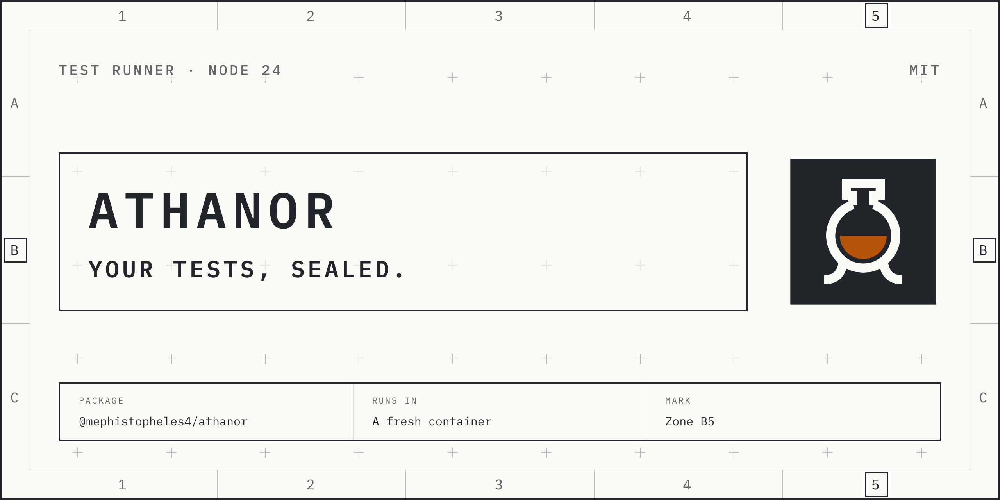

# athanor

Run a repo's tests on your current work in a fresh Linux container, with at
most N runs at once on the machine.

athanor is for many coding-agent sessions on one machine. Each session stays
on the host; only the test run goes into the container. Two suites can't
break each other through the file system or ports, and the machine stays
usable.

athanor is for repos you trust to build. The test run has no network, but the
image build runs the repo's own Dockerfile with network access.

## Install

Needs Node 24 or later, git 2.32 or later, and a Docker engine (Docker Desktop
on Windows).

athanor uses the Docker engine and buildx builder you have configured
(`DOCKER_HOST`, the Docker context and the buildx builder) when they are on
this machine: a unix socket, Docker Desktop's local pipe, or tcp to a loopback
address. `athanor run` refuses an engine or builder on another machine,
because your build context and your snapshot, uncommitted changes included,
would go to that machine. To use one anyway (an ssh engine, a build box, a
remote builder, or CI running Docker inside Docker on another host), set
`"allowRemoteDocker": true` in the machine configuration; each run then names
the engine or builder before it builds.

A plain `tcp://` engine or builder without TLS verification is refused too,
because your work and the test output would cross the network unencrypted.
Use `ssh://`, tcp with TLS verification, or a local engine; loopback addresses
pass. On a network you trust (a home lab, an office build box, a VM on this
machine, or CI running Docker inside Docker), set `"allowPlainTcp": true` in
the machine configuration; plain tcp to another host needs both keys. A repo
cannot set either. The machine configuration is read from the state folder,
which `ATHANOR_HOME` moves, so whoever sets a run's environment also chooses
which machine configuration it reads.

Don't run athanor on a Docker engine shared with people you don't trust:
anyone with access to the engine can read your runs and change their results.
Teammates you trust on an office build box are fine.

```bash
npm install --save-dev @mephistopheles4/athanor
```

The command is `athanor`.

## Set up a repo

Put the repo configuration in one of two places: an `athanor.json` file at the
repo root, or an `athanor` key in the `package.json` at the repo root. Use one,
never both: a run that finds both exits 125 and says to keep one.

As the `athanor` key in `package.json`:

```json
{
  "athanor": {
    "dockerfile": "test/Dockerfile",
    "context": "test",
    "inputs": ["package-lock.json"],
    "commands": { "test": ["npm", "test"], "fast": ["node", "test/run.mjs", "fast"] },
    "memory": "2g",
    "timeoutMinutes": 30
  }
}
```

The same object works as `athanor.json`, at the top level of the file with no
`athanor` wrapper, for a repo that has no `package.json` or does not want one:

```json
{
  "dockerfile": "test/Dockerfile",
  "commands": { "test": ["npm", "test"] }
}
```

Save `athanor.json` as UTF-8 without a byte-order mark. PowerShell 5.1's `>`
writes UTF-16, which athanor rejects as invalid JSON. Whichever
file you use must be a regular file inside the repo, not a link to a place
outside it.

- `dockerfile` (required) and `context` (default: the Dockerfile's folder)
  are repo-relative paths. Every tracked file under `context` keys the image,
  so keep it small.
- `inputs` lists files outside `context` that the build needs. Each must be
  tracked by git, and keeps its repo-relative path under the context root.
- `commands` maps names to argument arrays, or to objects (below). A string is
  an error.
- `memory` (`512m`, `2g`), `cpus` and `timeoutMinutes` default to the machine
  configuration. If that does not set them, `memory` is 2g and `timeoutMinutes`
  is 30. `cpus` has no default: with no `cpus` in either file (and no `maxCpus`),
  the container gets no CPU limit and may use every CPU the engine has.

A command can be an object, to give it limits, arguments or outputs of its own:

```json
"commands": {
  "test": ["npm", "test"],
  "mutation": {
    "argv": ["npx", "stryker", "run"],
    "args": true,
    "outputs": ["reports/mutation"],
    "timeoutMinutes": 90, "cpus": 4, "memory": "4g"
  }
}
```

`argv` is required. `args` (default `false`) lets `athanor run mutation -- …`
add arguments. `outputs` lists paths to copy out (see Use), relative to the
work folder: `$HOME/work` in the container, where the snapshot is unpacked, so
a repo-relative path. `memory`, `cpus` and `timeoutMinutes` take the command's own
value first, then the repo's top level, then the machine configuration, then
the default. The machine's `max*` ceilings hold for a command's own value.

The image must have `sh` and `tar`, and its user must be able to write
`$HOME/work`. An `ENTRYPOINT`, if any, must run the arguments it is given.

Start Chromium or Chrome in the container with `--no-sandbox`, or your repo's
own equivalent such as a wrapper script that adds it. Docker's default seccomp
profile, which athanor leaves in place, stops the browser starting its own
sandbox, so without the flag it fails with "No usable sandbox!" (or, run as
root, "Running as root without --no-sandbox is not supported"); Puppeteer
reports either as a failed launch. The test container, with no network and no
host folders, is the isolation in its place.

A test keeps six Linux capabilities (`CHOWN`, `DAC_OVERRIDE`, `FOWNER`, `KILL`,
`SETUID` and `SETGID`) and loses the other eight of Docker's defaults. A test
that needs one of the eight, such as `MKNOD` or `NET_RAW`, fails with a
permission error, and no configuration gives one back yet. If your tests need one of them, open
an issue naming the capability.

## Use

```bash
athanor run                 # run the "test" command
athanor run fast            # run another named command
athanor run --untracked     # include untracked, non-ignored files
athanor run -- node --test test/one.test.mjs
athanor run mutation -- --mutate src/a.ts   # arguments for a command that sets "args": true
athanor run mutation --output <your profile>/athanor-reports/mutation-1
athanor status              # who holds the slots, which containers exist
athanor prune --dry-run     # list images unused for 30 days
athanor prune --days 7
```

Every command takes `--json`: stdout then holds exactly one JSON object, and
everything else goes to stderr.

After a command name, everything after `--` is an argument for that command,
passed as literal words, `--json` included; with no name, `--` starts a whole
command, as `athanor run -- <cmd…>`. For Stryker, scope a run with
`-- --mutate src/a.ts`: a bare path would be read as its config file. Don't
pass secrets as arguments.

`--output <dir>` copies the command's `outputs` out of the stopped container
into `<dir>`, a folder athanor makes and that must not exist yet. It copies
after a test that passed, failed or was ended by the memory limit (the outcome
stays `memory`, exit 137, and a report cut off by the kill may be partly
written), and not after a timeout, an interrupt or an error. In the example, `<your profile>` is `$HOME` on Linux and
`%USERPROFILE%` on Windows, and `athanor-reports` must exist already; athanor
makes only the last folder:

- Pick a parent under your user profile and outside any folder a sync client
  mirrors. On Windows the folder inherits its parent's access rules. On Linux
  and macOS, athanor refuses a parent whose group or other write bit is set
  unless it has the sticky bit, since it cannot tell a private group (a umask of
  0002 makes one) from a shared one: run `chmod go-w` on the parent.
- A folder inside the repo shows up as untracked files, so add it to
  `.gitignore`.
- A folder is complete only when the run's result reports `outputs`: a run
  killed hard in the middle of a copy can leave a partial folder. With
  `--json`, the result's `outputs` field reports the copy: `dir`, `files`,
  `bytes`, `skipped` (links, devices and the files Windows acts on) and
  `missing` (declared paths the container did not have).

athanor copies regular files and folders, checks every name, and refuses the
whole copy on a bad one, or on a folder laid out as a bare git repository
(`HEAD` with `objects`, `refs` or `commondir`); links and devices are skipped, and so are
the files Windows acts on when it shows a folder (`desktop.ini`, `.lnk`, `.url`
and the like). A copy reads at
most `maxOutputMegabytes`, 100 000 entries and 10 minutes. A copy that fails
ends the run with exit 125 and the test's own exit in `testExitCode`.

A run tests your tracked files as they are in the working tree, staged or
not (a file added with `git add -N` counts), and tells you how many untracked
files it left out. It never changes your working tree, index, refs or stash
list; it writes outside the state folder only into an `--output` folder.

The files reach the container and the image build as committed: athanor pins
their line endings and file modes, and applies your repo's own
`.gitattributes` settings for `text`, `eol`, `ident` and
`working-tree-encoding`. The step that packs them into a tar stream
(`git archive`) runs no git content filter and does not read your global or
system git configuration, so a Git LFS file arrives as its pointer file. The git calls that record uncommitted work still run with your git
configuration, clean filters included
([issue 42](https://github.com/mephistopheles4/athanor/issues/42)). With Git
LFS, its clean filter can copy uncommitted files, and with `--untracked`
untracked ones, into the repo's `.git/lfs` folder, where they stay.

### Exit codes

| Code | Meaning |
| --- | --- |
| the test's own | the test command ran and exited with it |
| 124 | the time limit ended the run |
| 125 | athanor could not run the test: configuration, build, Docker, snapshot or environment; or the test ran but its outputs could not be copied (the test's exit is `testExitCode`) |
| 130 | an interrupt ended the run |
| 137 | with outcome `memory`, the memory limit ended the run |

The JSON `outcome` field (`pass`, `fail`, `timeout`, `memory`,
`interrupted`, `error`) tells a test's own 124, 125 or 130 apart from
athanor's.

## Machine configuration

An optional `~/.athanor/config.json` (or `$ATHANOR_HOME/config.json`):

```json
{ "maxRuns": 2, "memory": "2g", "timeoutMinutes": 30, "pruneDays": 30,
  "maxMemory": "8g", "maxTimeoutMinutes": 120, "allowPlainTcp": false,
  "allowRemoteDocker": false, "maxOutputMegabytes": 1024 }
```

`ATHANOR_MAX_RUNS` overrides `maxRuns` for one shell or for CI. A repo value
above a `max*` ceiling is an error. `maxMemory` and `maxTimeoutMinutes` default to
8g and 120. `maxCpus` has no default: when you set it, it also gives a run with
no `cpus` that many CPUs. Docker refuses a `cpus` above the CPUs the engine
has, and the run then ends with exit 125 and Docker's message. On Docker
Desktop the engine's CPUs are the VM's, which can be fewer than the host's, so
keep `maxCpus` at or below the engine's CPUs. `maxOutputMegabytes` (default
1024) is the most a copy to `--output` reads from the container; a repo cannot
set it.

The state folder holds copies of your uncommitted files while a run lasts, and
for up to a day after a run that was killed hard. If you set `ATHANOR_HOME`,
point it at a folder only you can read.

## Disk

`athanor prune` removes athanor's own images. It does not clear Docker's
build cache, which can hold copies of build contexts. Clear it with:

```bash
docker builder prune
```

With a named buildx builder, clear its cache with
`docker buildx prune --builder <name>`. With a remote engine or builder, these
copies sit on that machine.

## Proxy settings

Every run sets the ten proxy variables (`HTTP_PROXY`, `http_proxy`,
`HTTPS_PROXY`, `https_proxy`, `FTP_PROXY`, `ftp_proxy`, `NO_PROXY`, `no_proxy`,
`ALL_PROXY` and `all_proxy`) to empty in the test container, so a proxy
password in your Docker client configuration does not reach the test code. That
also blanks a value the image's own `ENV` gives them; the test container has
no network, so a proxy in it does nothing. The image build still gets the proxy
settings as build arguments, so a Dockerfile can read them, and a value the
build writes into the image can reach the test run (accepted risk 1 in
[the threat model](docs/threat-model.md)).

## Secrets

Keep secrets out of the files a run sends: everything tracked in the repo (a
file added with `git add -N` included) goes into the container, and with
`--untracked` so does every untracked file git doesn't ignore. Everything
tracked under `context` plus each `inputs` file goes into the image build,
which has network access; untracked files never do. With a remote engine, an operator can also choose the
files a copy to `--output` brings back.

## What athanor doesn't protect you from

Each line names the accepted risks in
[the threat model](docs/threat-model.md#accepted-risks) it comes from; the
threat model holds the full entries.

- **A repo you don't trust.** The image build runs the repo's Dockerfile with
  the network and gets your Docker client's proxy settings, passwords
  included. The tests run as root unless the Dockerfile names another user,
  and keep six Linux capabilities. Everything tracked under `context`, a
  file added with `git add -N` included, reaches that build. Use athanor only
  on repos you trust to build. Accepted risks 1 and 5.
- **A shared or remote engine.** Anyone who can use the engine can read your
  runs and change their results. With `allowRemoteDocker`, the engine's or
  builder's operator receives your work, decides the result and chooses the
  files an `--output` copy brings back, and a builder
  can ask this machine for your registry login. Don't share an engine with
  people you don't trust, and set `allowRemoteDocker` only for an engine and
  builder whose operator you trust with your work and your registry login.
  Accepted risks 7 and 8.
- **Plain tcp.** With `allowPlainTcp`, your work, the test output and copied
  outputs cross the network unencrypted. Set it only on a network you trust. Accepted risk 10.
- **A local address that leads elsewhere.** A socket, pipe or loopback port
  that athanor counts as local can be forwarded to another machine, or held by
  another local program. Know where your Docker endpoint leads. Accepted risk
  24.
- **Other local programs.** Any program on the machine can block runs, and
  read or fake what `status` shows about slot holders. On Windows, a user
  elsewhere on the network may also be able to read those details, and a
  program with the privilege to impersonate clients can act as you on a slot
  connection.
  Don't run athanor on a machine where you don't trust the other programs.
  Accepted risks 2, 3 and 9.
- **CPU.** With no `cpus` and no `maxCpus`, a run can use every CPU the
  engine has. A test that kills athanor's time limit inside the container,
  when athanor itself is killed hard, can leave the container running until
  the slot is next used. Set `maxCpus` for a bound. Accepted
  risks 4 and 17.
- **Your git configuration.** The git calls that record uncommitted work run
  your clean filters (files added with `git add -N` included), and Git LFS
  can copy uncommitted files into `.git/lfs`
  (see [Use](#use)). In a repo with a clean filter such as Git LFS, commit
  work before a run, or know that the filter sees it. Accepted risk 23.
- **What a copied file holds.** With `--output`, a report the test code wrote
  lands on your machine as written, and athanor checks names and types, never
  content. Opening it, or a viewer previewing it, does what it holds. athanor
  skips the file names that make Windows sign in to a place a file names when
  the folder is shown (`desktop.ini`, `.lnk`, `.url`, theme files and others),
  but not a spelling it does not know. It refuses a folder laid out as a bare
  git repository, but not every layout git might read as one: set
  `safe.bareRepository=explicit` in your git configuration so git does not
  treat a copied folder as a repository. Open
  outputs from a repo you trust to build. Accepted risk 28.
- **Plain files in the `--output` folder.** Copied outputs are ordinary files,
  with nothing encrypting them. They rely on your disk encryption and the
  folder's access rules; keep the folder where only you can read it. Accepted
  risk 31.
- **Command arguments.** The words after `<name> --` are visible in your
  machine's process list, in `docker inspect` on the engine, and to a remote
  engine's operator. Don't pass secrets as command arguments. Accepted risk 32.
- **Who can change the `--output` parent.** On Windows the folder inherits its
  parent's access rules, and under a parent other accounts can change, on any
  platform, they can read the copy or redirect a write while it runs. Pick a
  parent under your user profile. On Linux, athanor refuses a parent that other
  accounts can write unless it has the sticky bit. Accepted risk 30.
- **Your account name in messages.** A refusal about `allowRemoteDocker` or
  `allowPlainTcp` names the machine configuration file by its full path,
  which holds your home folder's name. It reaches whatever reads athanor's
  output, such as an agent session's model provider; keep that output out of
  places your account name shouldn't go. Accepted risk 25.

## More

- [AGENTS.md](AGENTS.md): rules for changing athanor.
- [docs/threat-model.md](docs/threat-model.md) and [SECURITY.md](SECURITY.md).
- [docs/adr/](docs/adr/): the lasting decisions.

Licence: MIT.
