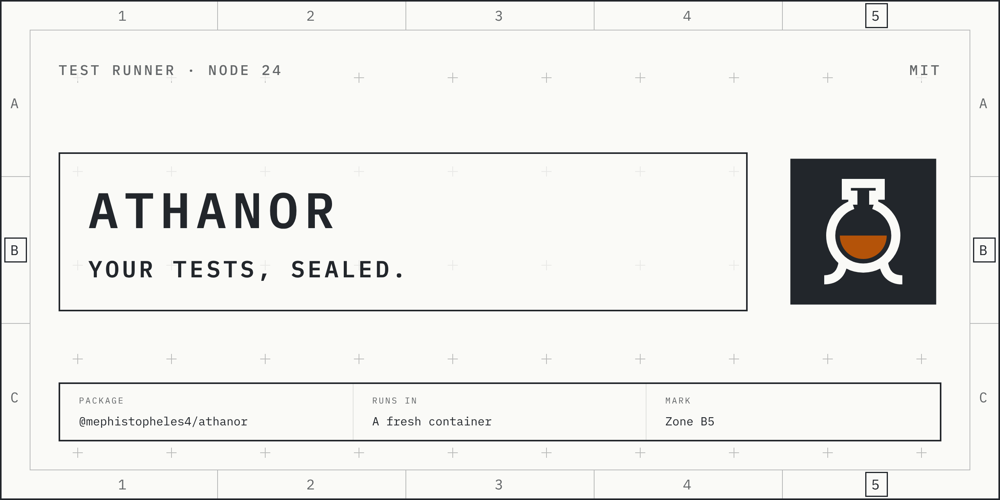

# athanor

Run a repo's tests on your current work in a fresh Linux container, with at
most N runs at once on the machine.

athanor is for many coding-agent sessions on one machine. Each session stays
on the host; only the test run goes into the container. Two suites can't
break each other through the file system or ports, and the machine stays
usable.

athanor is for repos you trust to build. The test run has no network, but the
image build runs the repo's own Dockerfile with network access.

## Install

Needs Node 24 or later, git 2.32 or later, and a Docker engine (Docker Desktop
on Windows).

athanor uses the Docker engine and buildx builder you have configured
(`DOCKER_HOST`, the Docker context and the buildx builder) when they are on
this machine: a unix socket, Docker Desktop's local pipe, or tcp to a loopback
address. `athanor run` refuses an engine or builder on another machine,
because your build context and your snapshot, uncommitted changes included,
would go to that machine. To use one anyway (an ssh engine, a build box, a
remote builder, or CI running Docker inside Docker on another host), set
`"allowRemoteDocker": true` in the machine configuration; each run then names
the engine or builder before it builds.

A plain `tcp://` engine or builder without TLS verification is refused too,
because your work and the test output would cross the network unencrypted.
Use `ssh://`, tcp with TLS verification, or a local engine; loopback addresses
pass. On a network you trust (a home lab, an office build box, a VM on this
machine, or CI running Docker inside Docker), set `"allowPlainTcp": true` in
the machine configuration; plain tcp to another host needs both keys. A repo
cannot set either. The machine configuration is read from the state folder,
which `ATHANOR_HOME` moves, so whoever sets a run's environment also chooses
which machine configuration it reads.

Don't run athanor on a Docker engine shared with people you don't trust:
anyone with access to the engine can read your runs and change their results.
Teammates you trust on an office build box are fine.

```bash
npm install --save-dev @mephistopheles4/athanor
```

The command is `athanor`.

## Set up a repo

Put the repo configuration in one of two places: an `athanor.json` file at the
repo root, or an `athanor` key in the `package.json` at the repo root. Use one,
never both: a run that finds both exits 125 and says to keep one.

As the `athanor` key in `package.json`:

```json
{
  "athanor": {
    "dockerfile": "test/Dockerfile",
    "context": "test",
    "inputs": ["package-lock.json"],
    "commands": { "test": ["npm", "test"], "fast": ["node", "test/run.mjs", "fast"] },
    "memory": "2g",
    "timeoutMinutes": 30
  }
}
```

The same object works as `athanor.json`, at the top level of the file with no
`athanor` wrapper, for a repo that has no `package.json` or does not want one:

```json
{
  "dockerfile": "test/Dockerfile",
  "commands": { "test": ["npm", "test"] }
}
```

Save `athanor.json` as UTF-8 without a byte-order mark. PowerShell 5.1's `>`
writes UTF-16, which athanor rejects as invalid JSON. Whichever
file you use must be a regular file inside the repo, not a link to a place
outside it.

- `dockerfile` (required) and `context` (default: the Dockerfile's folder)
  are repo-relative paths. Every tracked file under `context` keys the image,
  so keep it small.
- `inputs` lists files outside `context` that the build needs. Each must be
  tracked by git, and keeps its repo-relative path under the context root.
- `commands` maps names to argument arrays, or to objects (below). A string is
  an error.
- `memory` (`512m`, `2g`), `cpus` and `timeoutMinutes` default to the machine
  configuration. If that does not set them, `memory` is 2g and `timeoutMinutes`
  is 30. `cpus` has no default: with no `cpus` in either file (and no `maxCpus`),
  the container gets no CPU limit and may use every CPU the engine has.
- `processes` is the most processes, threads included, the container may
  hold: a whole number from 16 to 4194304. It defaults to the machine
  configuration's, else the smaller of 1024 and `maxProcesses`, and is held to
  `maxProcesses`. athanor 0.1.1 and older do not know it, and refuse a
  configuration that sets it with an unknown-key error.

A command can be an object, to give it limits, arguments or outputs of its own:

```json
"commands": {
  "test": ["npm", "test"],
  "mutation": {
    "argv": ["npx", "stryker", "run"],
    "args": true,
    "outputs": ["reports/mutation"],
    "timeoutMinutes": 90, "cpus": 4, "memory": "4g", "processes": 2048
  }
}
```

`argv` is required. `args` (default `false`) lets `athanor run mutation -- …`
add arguments. `outputs` lists paths to copy out (see Use), relative to the
work folder: `$HOME/work` in the container, where the snapshot is unpacked, so
a repo-relative path. `memory`, `cpus`, `timeoutMinutes` and `processes` take the
command's own value first, then the repo's top level, then the machine
configuration, then the default. The machine's `max*` ceilings hold for a
command's own value.

A command can also carry a base, for a check that compares the branch with
it, such as a version-bump rule:

```json
"check": { "argv": ["node", "scripts/check.mjs"], "base": "origin/main" }
```

With a base, the snapshot also carries the history from the merge base of the
base and your HEAD onward, on both sides. Inside the container `origin/main`
points at the base's tip, and HEAD sits on a branch named `athanor`: a commit
of the snapshot on top of your HEAD commit when your working tree differs from
it, and your HEAD commit itself on a clean tree. `git merge-base origin/main HEAD` and `git show
<merge-base>:<path>` answer as they do on the host. HEAD inside is the
snapshot, so a check that compares HEAD with the base also counts your
uncommitted edits (and, with `--untracked`, untracked files), which the same
check run on the host, reading only commits, would not.

- A command's `base` may name only a remote-tracking branch or a tag.
  `athanor run --base <name>` sets the base for one run, a local branch
  included, and overrides the command's.
- Name the base directly. A name that goes through a symbolic ref, such as
  `origin` for `origin/HEAD`, is refused, since only the branch it points at
  would exist inside; name that branch, such as `origin/main`. A name in
  capitals, such as `HEAD`, is read as git's own pseudo ref: name such a tag
  or branch in full, such as `refs/tags/RELEASE`.
- The base is only as fresh as your last `git fetch`: athanor never fetches.
- A shallow or partial clone is refused, since part of the history may be
  missing, and so is a snapshot that holds a path named `.athanor-base`.
- The image needs git for a run with a base, 2.29 or later for a sha256 repo.
- athanor 0.2.0 is the first release that takes `base` and `--base`. A repo
  that adopts the key needs 0.2.0 or later: an older athanor refuses the
  unknown key.

A mutation run's memory and processes grow with its runners: in one measured
Stryker run, about 1.3 GiB of memory and about 65 processes per runner at peak.
Give that command its own `memory` and `processes`, and raise `maxMemory` and
`maxProcesses` on the machine to fit. Keep `maxProcesses` times the largest run
limit any caller uses (`maxRuns`, or `ATHANOR_MAX_RUNS` where set), plus what
the engine's other containers use, well below the engine's process limit. That
limit is the kernel's process and thread limit as a container on that engine
sees it: `cat /proc/sys/kernel/pid_max /proc/sys/kernel/threads-max` in any
container prints both. A run that hits its process limit shows "Resource
temporarily unavailable", a failed thread or process start, or a native crash
early in the run; raise `processes` for that command.

The image must have `sh` and `tar`, and its user must be able to write
`$HOME/work`. An `ENTRYPOINT`, if any, must run the arguments it is given.

Start Chromium or Chrome in the container with `--no-sandbox`, or your repo's
own equivalent such as a wrapper script that adds it. Docker's default seccomp
profile, which athanor leaves in place, stops the browser starting its own
sandbox, so without the flag it fails with "No usable sandbox!" (or, run as
root, "Running as root without --no-sandbox is not supported"); Puppeteer
reports either as a failed launch. The test container, with no network and no
host folders, is the isolation in its place.

A test keeps six Linux capabilities (`CHOWN`, `DAC_OVERRIDE`, `FOWNER`, `KILL`,
`SETUID` and `SETGID`) and loses the other eight of Docker's defaults. A test
that needs one of the eight, such as `MKNOD` or `NET_RAW`, fails with a
permission error, and no configuration gives one back yet. If your tests need one of them, open
an issue naming the capability.

## Use

```bash
athanor run                 # run the "test" command
athanor run fast            # run another named command
athanor run --untracked     # include untracked, non-ignored files
athanor run -- node --test test/one.test.mjs
athanor run mutation -- --mutate src/a.ts   # arguments for a command that sets "args": true
athanor run mutation --output <your profile>/athanor-reports/mutation-1
athanor run check --base origin/main   # carry a base for a check that compares with it
athanor status              # who holds the slots, which containers exist
athanor prune --dry-run     # list images unused for 30 days
athanor prune --days 7
athanor serve dev           # run a server from "servers"; see "Serving a dev server"
```

Every command but `serve` takes `--json` as one JSON object (`serve` writes two lines, below): stdout then holds exactly one JSON object, and
everything else goes to stderr. With a base, the run's result has a `base`
field: the full ref name (`ref`), its tip (`tip`) and the merge base
(`mergeBase`), as full ids.

After a command name, everything after `--` is an argument for that command,
passed as literal words, `--json` included; with no name, `--` starts a whole
command, as `athanor run -- <cmd…>`. For Stryker, scope a run with
`-- --mutate src/a.ts`: a bare path would be read as its config file. Don't
pass secrets as arguments.

`--output <dir>` copies the command's `outputs` out of the stopped container
into `<dir>`, a folder athanor makes and that must not exist yet. It copies
after a test that passed, failed or met the memory limit (the outcome
stays `memory`, exit 137, and a report cut off by the kill may be partly
written), and not after a timeout, an interrupt or an error. In the example, `<your profile>` is `$HOME` on Linux and
`%USERPROFILE%` on Windows, and `athanor-reports` must exist already; athanor
makes only the last folder:

- Pick a parent under your user profile and outside any folder a sync client
  mirrors. On Windows the folder inherits its parent's access rules. On Linux
  and macOS, athanor refuses a parent whose group or other write bit is set
  unless it has the sticky bit, since it cannot tell a private group (a umask of
  0002 makes one) from a shared one: run `chmod go-w` on the parent.
- A folder inside the repo shows up as untracked files, so add it to
  `.gitignore`.
- A folder is complete only when the run's result reports `outputs`: a run
  killed hard in the middle of a copy can leave a partial folder. With
  `--json`, the result's `outputs` field reports the copy: `dir`, `files`,
  `bytes`, `skipped` (links, devices and the files Windows acts on) and
  `missing` (declared paths the container did not have).

athanor copies regular files and folders, checks every name, and refuses the
whole copy on a bad one, or on a folder laid out as a bare git repository
(`HEAD` with `objects`, `refs` or `commondir`); links and devices are skipped, and so are
the files Windows acts on when it shows a folder (`desktop.ini`, `.lnk`, `.url`
and the like). A copy reads at
most `maxOutputMegabytes`, 100 000 entries and 10 minutes. A copy that fails
ends the run with exit 125 and the test's own exit in `testExitCode`; after a
memory run, `testExitCode` is athanor's 137, not the test's, and
`containerExitCode` holds the container's own exit.

A run tests your tracked files as they are in the working tree, staged or
not (a file added with `git add -N` counts), and tells you how many untracked
files it left out. It never changes your working tree, index, refs or stash
list; it writes outside the state folder only into an `--output` folder.

The files reach the container and the image build as committed: athanor pins
their line endings and file modes, and applies your repo's own
`.gitattributes` settings for `text`, `eol`, `ident` and
`working-tree-encoding`. The step that packs them into a tar stream
(`git archive`) runs no git content filter and does not read your global or
system git configuration, so a Git LFS file arrives as its pointer file. The git calls that record uncommitted work still run with your git
configuration, clean filters included
([issue 42](https://github.com/mephistopheles4/athanor/issues/42)). With Git
LFS, its clean filter can copy uncommitted files, and with `--untracked`
untracked ones, into the repo's `.git/lfs` folder, where they stay.

### Exit codes

| Code | Meaning |
| --- | --- |
| the test's own | the test command ran and exited with it |
| 124 | the time limit ended the run |
| 125 | athanor could not run the test: configuration, build, Docker, snapshot or environment; or the test ran but its outputs could not be copied (`testExitCode`: the test's exit, or athanor's 137 after a memory run) |
| 130 | an interrupt ended the run |
| 137 | with outcome `memory`, the memory limit killed a process in the container: the test itself, or another process before the test exited |

The JSON `outcome` field (`pass`, `fail`, `timeout`, `memory`,
`interrupted`, `error`) tells a test's own 124, 125 or 130 apart from
athanor's.

Docker reports a memory kill for the whole container, not for one process,
so any kill during the run makes the outcome `memory`. The JSON
`containerExitCode` field, set only then, is the container's own exit: 137
when the test itself was killed, or exited 137 on its own, and otherwise the
test's exit after another process, such as a worker, was killed. In that case the
line athanor prints at the end of the run says so, and the test's result may
be incomplete.

## Serving a dev server

`athanor run` tests a snapshot with no network. `athanor serve` is for a dev
server you want to open in a browser while you edit: it runs a server from
your repo's `servers` in a container that sees your working tree live and
publishes one port on 127.0.0.1.

```json
"servers": {
  "dev": {
    "argv": ["env", "CHOKIDAR_USEPOLLING=1", "pnpm", "dev", "--host", "0.0.0.0"],
    "port": 4321,
    "writable": ["node_modules", "packages/site/node_modules", "packages/site/.astro"],
    "memory": "4g"
  }
}
```

```bash
athanor serve dev               # a free port on 127.0.0.1; the URL is printed
athanor serve dev --port 5000   # host port 5000
athanor serve dev --json
```

`servers` sits beside `commands`, in `athanor.json` or under `package.json`'s
`athanor` key. Each server has:

- `argv`: the command, a non-empty array of strings, as a command's.
- `port`: the port the server listens on in the container, 1 to 65535.
  Required.
- `writable`: optional, repo-relative folders the server may write (see
  below). Written as `inputs` are: inside the repo, forward slashes, no `..`,
  no repeats, none inside another.
- `memory`, `cpus` and `processes`: optional limits, checked against the
  machine ceilings as a command's are. The repo-level values apply to a server
  that sets none.

No other key is allowed in a server: `timeoutMinutes`, `args`, `outputs` and
`base` are refused. A name can't be both a command and a server.
`athanor run dev` never reads `servers`; if `dev` is only a server, it says so.

What the container gets:

- **The whole working tree, read-only, at the image's `WORKDIR`.** That is
  every file in the folder, untracked and gitignored files and `.git`
  included, as it is now: an edit on the host shows in the next read. Set
  `WORKDIR` in the Dockerfile to the folder where it installs the repo's
  dependencies. The server can't write the tree, and athanor never does.
- **A fresh volume for each `writable` folder.** The folder holds the image's
  content, not the host's, and is new on every start. It must exist on the
  host as a folder, not a link (athanor never creates it; `mkdir` it), and
  the image must have it as a folder the image's user can write: add
  `RUN mkdir -p <path>` after `USER`, or `COPY --chown`. `serve` checks both
  before it starts the container and says which path and what to do.
- **A network, with outbound access.** The container is on Docker's default
  bridge network. The server must listen on `0.0.0.0` inside the container
  (for Astro and Vite, `--host 0.0.0.0`), or the published port can't reach it.
- **One published port, on 127.0.0.1 only.** Without `--port`, Docker picks a
  free host port, so two servers never collide. With `--port <n>`, a port
  already in use fails with Docker's message and exit 125.
- The same limits, six kept capabilities, `no-new-privileges` and proxy
  blanks as a run's container, and no time limit.

On Docker Desktop for Windows, a change on the host doesn't wake a file
watcher inside the container, so make the dev server poll: in the example,
`CHOKIDAR_USEPOLLING=1` before the command, or Vite's `server.watch.usePolling`.
Each start copies the image's content into each writable volume, so a large
`node_modules` makes the start slower.

`serve` runs in the foreground until you stop it or the server exits. It
prints `serving <name> at http://127.0.0.1:<port>/ (stop with Ctrl-C).` on
stderr once Docker has published the port. That means the port is published,
not that the server is listening yet: the server's own output says when it
does. The server's output goes to stdout, or to stderr with `--json`.

Stop it with Ctrl-C, or with a signal such as SIGTERM to athanor's process (an
agent that stops a background task sends one). athanor then removes the
container and its volumes. Don't kill athanor's process hard: on Windows that
leaves the container running until the next `athanor serve` removes it, and
`athanor status` lists it as an orphan until then. On Linux, a hard
kill ends the container's input, and the server stops within a few seconds.

| Exit | Outcome | Meaning |
| --- | --- | --- |
| 130 | `stopped` | a signal ended it |
| the server's own | `exited` | the server exited by itself, with any code, 0 too |
| 137 | `memory` | Docker reports the memory limit killed a process |
| 125 | `error` | athanor could not serve: configuration, build, Docker, a port in use, or a published port Docker did not report |

With `--json`, stdout holds two lines, each one JSON object. The first is
`{ "schema": 1, "event": "serving", "server", "url", "port", "lock" }`, written once the port is
published. The last is `{ "schema": 1, "event": "ended", "outcome", "exitCode", "ranMs"?, "message"? }`.
`ranMs` is how long the container ran, and it is there only when the container
started. A failure before `serving` writes only the `ended` line, with
`outcome: "error"`, a bad flag or a configuration error included. `serve` never
writes `run`'s error object.

A server holds no run slot, so a server doesn't make a test run wait. It holds
a server lock instead: `maxServers` in the machine configuration (default 2)
is how many run at once on the machine. With every lock held, `serve` exits
125 at once and says so. `athanor status` lists the held locks and any server
container. If you lower `maxServers` below a container's lock number, the next
`serve` doesn't sweep it; remove it with `docker rm -f -v <name>`.

`serve` needs a Docker engine on this machine, and refuses any other, even
with `allowRemoteDocker`: a bind mount takes its path from the engine's
machine, and 127.0.0.1 is that machine's. A remote builder stays under a
run's rules.

athanor 0.2.0 is the first release with `serve`. A repo that adds `servers`,
or a machine file that adds `maxServers`, needs 0.2.0 or later wherever
athanor runs on it, CI included: an older athanor refuses the unknown key and
runs nothing.

## Machine configuration

An optional `~/.athanor/config.json` (or `$ATHANOR_HOME/config.json`):

```json
{ "maxRuns": 2, "memory": "2g", "timeoutMinutes": 30, "pruneDays": 30,
  "maxMemory": "8g", "maxTimeoutMinutes": 120, "allowPlainTcp": false,
  "allowRemoteDocker": false, "maxOutputMegabytes": 1024,
  "processes": 1024, "maxProcesses": 1024, "maxServers": 2 }
```

`ATHANOR_MAX_RUNS` overrides `maxRuns` for one shell or for CI. `maxServers`
(default 2, a positive whole number) is how many `athanor serve` servers run
at once on the machine; it has no environment variable. A repo value
above a `max*` ceiling is an error. `maxMemory` and `maxTimeoutMinutes` default to
8g and 120. `maxCpus` has no default: when you set it, it also gives a run with
no `cpus` that many CPUs. Docker refuses a `cpus` above the CPUs the engine
has, and the run then ends with exit 125 and Docker's message. On Docker
Desktop the engine's CPUs are the VM's, which can be fewer than the host's, so
keep `maxCpus` at or below the engine's CPUs. `maxOutputMegabytes` (default
1024) is the most a copy to `--output` reads from the container; a repo cannot
set it. `maxProcesses` (default 1024) is the ceiling for `processes`; raising
it never raises the default, and lowering it below 1024 lowers the default.
Every athanor on the machine reads this file, so once it holds `processes` or
`maxProcesses`, athanor 0.1.1 and older refuse it, and every run with them. Once it holds `maxServers`, athanor 0.1.1 and older refuse it too.

The state folder holds copies of your uncommitted files while a run lasts, and
for up to a day after a run that was killed hard. With a base, it also holds a
pack of the history from the merge base onward, until the run has streamed it
into the container (or, if it can't be removed then, until the run ends), and
for up to a day after a run that was killed hard. If you set
`ATHANOR_HOME`, point it at a folder only you can read.

## Disk

`athanor prune` removes athanor's own images. It does not clear Docker's
build cache, which can hold copies of build contexts. Clear it with:

```bash
docker builder prune
```

With a named buildx builder, clear its cache with
`docker buildx prune --builder <name>`. With a remote engine or builder, these
copies sit on that machine.

## Proxy settings

Every run sets the ten proxy variables (`HTTP_PROXY`, `http_proxy`,
`HTTPS_PROXY`, `https_proxy`, `FTP_PROXY`, `ftp_proxy`, `NO_PROXY`, `no_proxy`,
`ALL_PROXY` and `all_proxy`) to empty in the test container, so a proxy
password in your Docker client configuration does not reach the test code. That
also blanks a value the image's own `ENV` gives them; the test container has
no network, so a proxy in it does nothing. The image build still gets the proxy
settings as build arguments, so a Dockerfile can read them, and a value the
build writes into the image can reach the test run (out of scope, a repo's own
code, in [the threat model](docs/threat-model.md#scope)).

## Secrets

Keep secrets out of the files a run sends: everything tracked in the repo (a
file added with `git add -N` included) goes into the container, and with
`--untracked` so does every untracked file git doesn't ignore. With a base, the commits from the merge base onward go too, with every file they hold, deleted ones included. Everything
tracked under `context` plus each `inputs` file goes into the image build,
which has network access; untracked files never do. With a remote engine, an operator can also choose the
files a copy to `--output` brings back.

## What athanor doesn't protect you from

Each line names the accepted threat class in
[the threat model](docs/threat-model.md#accepted-threat-classes) it comes from,
or says it is out of scope; the threat model holds the full class.

- **A repo you don't trust.** athanor is not a sandbox: it keeps parallel
  runs from colliding, and does not contain a hostile repo. The image build
  runs the repo's Dockerfile with the network and gets your Docker client's
  proxy settings, passwords included. The tests run as root unless the
  Dockerfile names another user, and keep six Linux capabilities. Everything
  tracked under `context`, a file added with `git add -N` included, reaches
  that build. Use athanor only on repos you trust to build. Out of scope: a
  repo's own code, in the threat model's [Scope](docs/threat-model.md#scope).
- **A shared or remote engine.** Anyone who can use the engine can read your
  runs and change their results. With `allowRemoteDocker`, the engine's or
  builder's operator receives your work, decides the result and chooses the
  files an `--output` copy brings back, and a builder
  can ask this machine for your registry login. Don't share an engine with
  people you don't trust, and set `allowRemoteDocker` only for an engine and
  builder whose operator you trust with your work and your registry login.
  Accepted class "A shared or remote engine, and the network".
- **Plain tcp.** With `allowPlainTcp`, your work, the test output and copied
  outputs cross the network unencrypted. Set it only on a network you trust. Accepted class "A shared or remote engine, and the network".
- **A local address that leads elsewhere.** A socket, pipe or loopback port
  that athanor counts as local can be forwarded to another machine, or held by
  another local program. Know where your Docker endpoint leads. Accepted class
  "A shared or remote engine, and the network"; a local program holding it is
  the class "A compromised machine or sandbox".
- **The Windows slot pipe on the network.** On Windows, a user elsewhere on
  the network may be able to read what `status` shows about slot holders:
  pid, start time, repo folder name and limit, and, for a server, its name and port. On a network whose signed-in
  users you don't trust with those details, keep repo folder names you'd
  rather not show off the machine's runs. Accepted class "The Windows slot
  pipe on the network".
- **A server's port.** `athanor serve` binds to 127.0.0.1, so any program on this machine, and any other container on Docker's default network, can reach your dev server. On Linux, use Docker Engine 28.0 or later: older engines let other hosts on your network reach ports on 127.0.0.1. Don't serve on a machine whose other users you don't trust with your dev server. Accepted class "A server's port on this machine".
- **A compromised machine or sandbox.** Any program on the machine can block
  runs, read or fake what `status` shows about slot holders, and, with the
  privilege to impersonate clients, act as you on a slot connection. Don't
  run athanor on a machine where you don't trust the other programs. Once a
  program, process or agent on
  your machine or in your sandbox works against you, it can plant programs a
  bare command name runs, change files a session or a hook reads, and act as a
  session would. athanor does not defend against it. Keep the machine and the
  sandbox free of what you don't trust. Accepted class "A compromised machine or sandbox".
- **CPU.** With no `cpus` and no `maxCpus`, a run can use every CPU the
  engine has. A test that kills athanor's time limit inside the container,
  when athanor itself is killed hard, can leave the container running until
  the slot is next used, and it keeps the run's snapshot, uncommitted files
  included, until it is removed. A server killed hard on Windows keeps running until the next `athanor serve`; `athanor status` shows it, and `docker rm -f -v <name>` removes it. Set `maxCpus` for a bound. Accepted
  class "The machine's load".
- **Processes.** If you raise `maxProcesses`, a repo can let a run's test code
  start up to that many processes. All runs share the engine's process table,
  the whole host's on Linux. Filling it stops the engine and other programs
  from starting processes, and can keep athanor from stopping a run at its
  time limit. A container left running then may not be removable until you
  restart the engine (on Linux, recover the host), and until it is removed it
  keeps the run's snapshot, uncommitted files included. A restart stops it but
  does not remove it: the next run on its slot removes it, or you remove it
  yourself (`athanor status` lists it). Keep `maxProcesses`
  times your largest run limit well below your
  engine's process limit ([Set up a repo](#set-up-a-repo) shows how to read
  it). Accepted class "The machine's load".
- **Your git configuration.** The git calls that record uncommitted work run
  your clean filters (files added with `git add -N` included), and Git LFS
  can copy uncommitted files into `.git/lfs`
  (see [Use](#use)). In a repo with a clean filter such as Git LFS, commit
  work before a run, or know that the filter sees it. Accepted class "What athanor records, shows and leaves behind".
- **What a copied file holds.** With `--output`, a report the test code wrote
  lands on your machine as written, and athanor checks names and types, never
  content. Opening it, or a viewer previewing it, does what it holds. athanor
  skips the file names that make Windows sign in to a place a file names when
  the folder is shown (`desktop.ini`, `.lnk`, `.url`, theme files and others),
  but not a spelling it does not know. It refuses a folder laid out as a bare
  git repository, but not every layout git might read as one: set
  `safe.bareRepository=explicit` in your git configuration so git does not
  treat a copied folder as a repository. Open
  outputs from a repo you trust to build. Out of scope, a repo's own code;
  from a remote engine, accepted class "A shared or remote engine, and the
  network".
- **Plain files in the `--output` folder.** Copied outputs are ordinary files,
  with nothing encrypting them. They rely on your disk encryption and the
  folder's access rules; keep the folder where only you can read it. Accepted
  class "What athanor records, shows and leaves behind".
- **Command arguments.** The words after `<name> --` are visible in your
  machine's process list, in `docker inspect` on the engine, and to a remote
  engine's operator. Don't pass secrets as command arguments. Accepted class "What athanor records, shows and leaves behind".
- **Who can change the `--output` parent.** On Windows the folder inherits its
  parent's access rules, and under a parent other accounts can change, on any
  platform, they can read the copy or redirect a write while it runs. Pick a
  parent under your user profile. On Linux, athanor refuses a parent that other
  accounts can write unless it has the sticky bit. Accepted class "What athanor records, shows and leaves behind".
- **Your account name in messages.** Any message about the machine
  configuration file (a refusal, a bad value, an unknown key, a value above a
  ceiling) names it by its full path, and a git error from a named base's
  steps can name a path in the state folder or the repo's own path;
  both hold your home folder's name. It reaches whatever reads athanor's
  output, such as an agent session's model provider; keep that output out of
  places your account name shouldn't go. Accepted class "What athanor records, shows and leaves behind".
- **A named base.** With `--base` or a command's `base`, a run also sends the
  history from the merge base onward: files deleted since, and commit
  messages, authors' names, emails and dates. The test code can read it, and
  it goes wherever your snapshot goes, a remote or shared engine and plain tcp
  included. Name a base only for checks that need it, and remove a leaked
  secret from the history, not only from the tree. Accepted class "What athanor records, shows and leaves behind".

## More

- [AGENTS.md](AGENTS.md): rules for changing athanor.
- [docs/threat-model.md](docs/threat-model.md) and [SECURITY.md](SECURITY.md).
- [docs/adr/](docs/adr/): the lasting decisions.

Licence: MIT.
