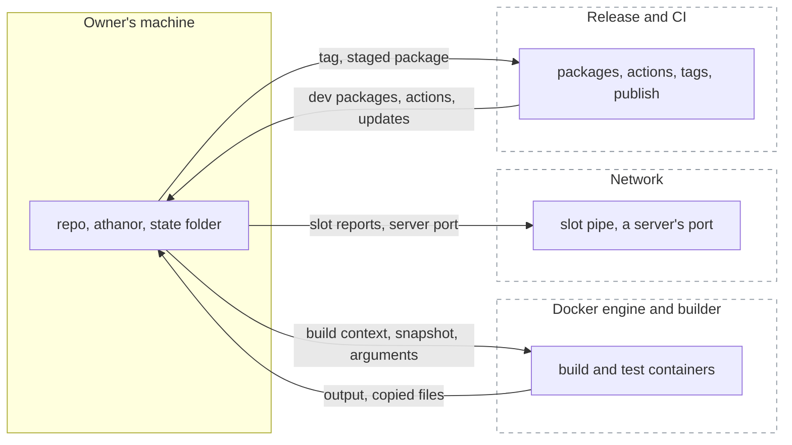
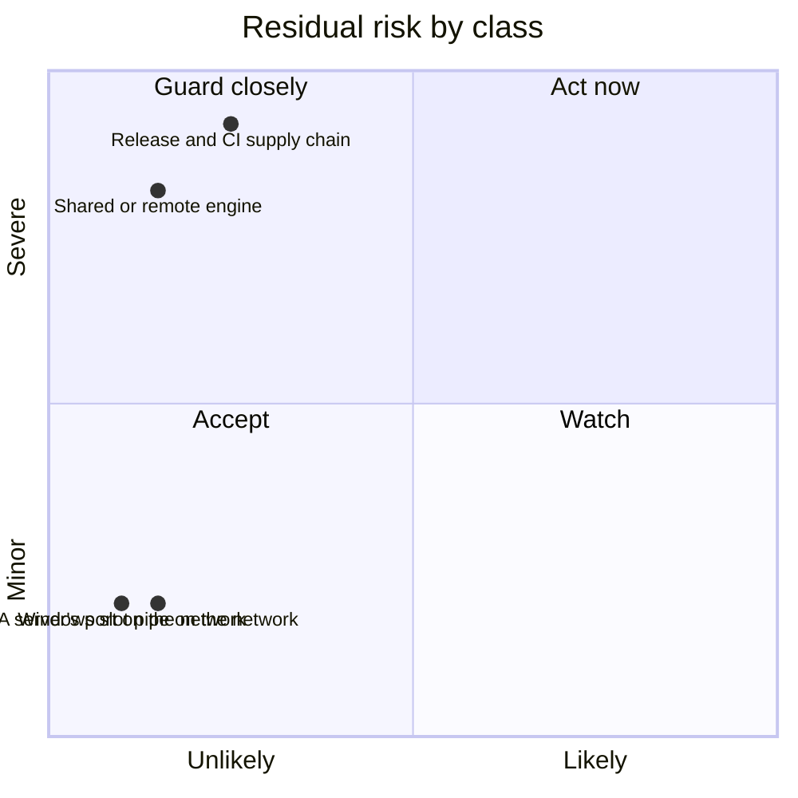

# Threat model

Read the boundaries first. Place each finding on one: where something
comes in from outside, or where an act goes out. What starts and ends on
the machine (your own computer, or a sandbox run on it) is the machine's,
and no finding; what came in from outside stays outside input. Name the
control that holds the boundary against the path, with when it doesn't
hold; if one does, add nothing. Check the residual against the classes.
Bring the owner what the guide's step 5 lists, every `security?` row
included; no class covers a change that weakens a rule or control, adds a
route for outside text into a session or more reach to one that reads it,
adds text to files sessions load, or writes a secret into text sessions
read. The full guide is the pact's review procedure, The threat model
section (`~/.claude/pact/review.md`; public copy:
https://github.com/mephistopheles4/the-pact/blob/main/claude/review.md).

[`SECURITY.md`](../SECURITY.md) says how to report a hole. The sensitive-work
list is in [`sensitive-work.md`](sensitive-work.md), which keeps the old class
names: the machine and records classes are now the machine's (see Scope), and
"the supply-chain bullet" is the Release and CI boundary.

## Boundaries

### The Docker engine and builder

**Crosses:** out, the build context, the snapshot (with a base, the history
from the merge base onward: deleted files, authors, emails and messages), the
build arguments, and a command's arguments, which also sit in the engine's
record of the container; in, the test's output and the files `--output`
copies back. An engine only the owner uses, on this machine, is the machine's.
The boundary is an engine shared with others or on another machine, a builder
likewise, and a local address that leads elsewhere.

**Controls:**

- **athanor** refuses an engine or builder that is not local (a unix socket,
  the local pipe in its exact form, loopback tcp), a builder whose transport it
  could not read, and plain tcp, unless the machine file sets
  `allowRemoteDocker` or `allowPlainTcp`; a repo cannot set either. The machine
  file follows `ATHANOR_HOME`, which whatever sets the environment can move.
  What it checked is pinned for the run and checked again once the slot is held
  (ADR 0013, ADR 0021). It does not hold when an opt-in is set, or when a local
  address (`localhost` included) is forwarded elsewhere. Then the operator
  decides the result and the limits, can see the work, the build arguments and
  what the build leaves in image layers or cache, a builder can ask this
  machine for the owner's registry login, and a remote builder host sees the
  connection and, for an ssh node, the owner's login. On a shared engine other
  users can read runs, put their image under the run's tag and remove
  containers. With `allowPlainTcp`, anyone on the path can read and change the
  work, the output and the copied files. `serve` refuses an engine off this
  machine even with `allowRemoteDocker` (ADR 0034).
- **athanor** sends the build only the hashed set: tracked files under
  `context` and the listed `inputs`, plus `git add -N` files under `context`,
  never untracked, ignored or git files (ADR 0006). It does not hold for the
  run's container: the snapshot carries uncommitted work, and `--untracked`
  adds untracked files git doesn't ignore.
- **athanor** gives a run's container nothing from the host but the snapshot
  and `ATHANOR_GRACE_LIMIT`: no mount, no socket, `--network none`, the ten
  proxy names set empty so a proxy password stays out of the engine's record,
  and no engine log of the output (ADR 0016). With no network, the snapshot
  and a base's history in the container cannot leave it that way; loosening
  that opens an outbound crossing no class covers. These do not hold on an
  engine whose operator decides what is enforced, nor for a proxy name a later
  Docker client adds before the list is updated, nor for the image build,
  which has the network and gets the proxy settings as build arguments.
- **athanor** checks what `--output` copies back: names as text, regular files
  and folders only, exclusive creates, size, count and time caps, cleanup on
  error, file names Windows acts on when it shows a folder skipped, and a folder
  laid out as a bare git repository refused (ADR 0023). It does not hold for a spelling or layout it
  does not know, and never checks content: a copied file carries no
  Mark-of-the-Web, and opening or previewing it does what it holds. A remote
  operator chooses what the copy holds. The README advises
  `safe.bareRepository=explicit`.

**Residual:** the class "A shared or remote engine, and the network". It rests
on AGENTS.md's rules for the run container (ADR 0016), and on the README's
advice not to share an engine with people you don't trust.

### What athanor exposes on the network

**Crosses:** out, a slot holder's report (pid, start time, repo folder name,
limit, and a server's name and host port) on the Windows slot pipe, and a
server's published port.

**Controls:**

- **Windows** signs a user in before the pipe. It does not hold: the pipe does
  not refuse remote clients.
- **athanor** publishes a server's port on 127.0.0.1 only, and if Docker
  reports another address it removes the container and exits 125 (ADR 0034). It
  does not hold on a Linux engine before 28.0, where hosts on the same segment
  can reach a loopback port, and athanor does not check the version; nor
  against another container on Docker's default bridge network, which can
  reach the port at the container's own address.

**Residual:** the classes "The Windows slot pipe on the network" and "A
server's port on the network". They rest on the README's advice for each.

### Release and CI

**Crosses:** in, dev packages, actions and the update bot's pull requests; out,
the tag, the staged package, the published version and the GitHub release.

**Controls:**

- **GitHub** (read from GitHub when this page was written): rulesets on `main` (a pull request, the required
  check `ci`, no deletion, no non-fast-forward), on tag creation (limited to
  admins) and on tag updates and deletions (blocked); immutable releases; secret
  scanning with push protection; Dependabot security updates; CodeQL default
  setup; and the `npm` environment's required reviewer, which gates the
  identity token. They do not hold against an admin who changes a ruleset;
  secret scanning matches credentials, not code, and CodeQL finds only what its
  queries know. The reviewer holds only as far as npm enforces the environment
  the trusted publisher names (unconfirmed).
- **Repo files:** Dependabot waits 7 days before it proposes an update, security
  updates excepted; a bot pull request's passing check is not evidence of
  safety, and the owner's merge is the control. Actions are pinned by full SHA
  and zizmor checks each pin; install scripts are off; the lockfile pins hashes
  and `npm audit signatures` checks registry signatures; CI holds no secrets and
  a read-only token. None of these sees a hijacked compiler, which every build
  uses, and a pin names a commit, not that it is safe. The workflow check and
  the release guards (the owner as actor, the tagged commit being `main`'s head
  or an ancestor of it, CI green, the tag matching the version) catch honest mistakes only, and a tag
  run uses the workflow file at its commit (ADR 0035).
- **npm** binds the trusted publisher to `release.yml` and the `npm`
  environment, stages only,
  and makes a version live only on the owner's two-factor approval (ADR 0019).
  It does not hold when an action in `publish` asks for the identity token and
  stages another file or version or gets a Sigstore signature in this
  workflow's name for some other file, or when `check` changes a packed file;
  the owner's look catches the staged ones. The published manifest is first seen after the
  version is live, so a bad one is unpublished while npm's policy allows, else
  deprecated.
- **Repo files, package.json:** no runtime dependencies (ADR 0001), so the
  compiler is the one dev package that runs. It holds nothing against that
  compiler.

**Residual:** the class "The release and CI supply chain". It rests on the
owner's rules in `docs/releasing.md`: comparing every staged file with a local
pack before login, and reading each GitHub release as a draft (ADR 0031). A
merged hijacked compiler runs as the owner and can read what the owner's
account can, the `gh` login's reach (private security advisories included) and,
from `npm login` to `npm logout`, the unencrypted npm session token (a rebuild
uses the same compiler). Any tag already pushed can still be released. An
action in `publish` could stage the owner's reviewed release candidate under
`latest` if `npm stage view` shows no dist-tag. No repository setting limits who
publishes a GitHub release, which Zenodo then archives for good. Whoever
controls the owner's GitHub account or can push a branch can stage a version;
against whoever holds the account, only stage-only publishing and npm
two-factor approval hold.

## Scope

**In scope:** the boundaries above: a shared or remote engine or builder, what
athanor exposes on the network, and release and CI.

**Out of scope:**

- **The machine.** Every program, process, account, file and memory made there
  is the machine's, held by its own controls (antivirus, account isolation, disk
  encryption). That covers other local programs and accounts (they can take
  slot names, fake `status`, or swap a file a run reads), the records athanor
  leaves behind (the state folder, `--output` folders and their parents' access
  rules, leftover containers, a clean filter's writes in the repo's git folder,
  and paths in messages), and machine load: CPU, the engine's process table, a
  server's missing time limit (ADR 0033). Anything on the machine or processed
  by it is out of scope, unless it came in from outside or touches the
  sensitive-work list (a change to an access rule or credential that list names
  is still a finding); what athanor sends to an engine is the Engine boundary's.
- **A repo's own code.** athanor isolates parallel runs so they don't collide;
  it is not a sandbox for a repo you don't trust (ADR 0033). The build runs the
  repo's Dockerfile with the network and the Docker client's proxy settings,
  so a build step can send a proxy password out or leave it in the image or
  the build cache (which `prune` does not clear), and a `FROM` line can pull
  the owner's private images with their registry login. The test runs as the
  image's user with six capabilities. A copied report lands as written, and
  git's error text, printed as written, can carry terminal escape codes.
- **Third parties relied on:** Docker, Docker Desktop and its VM, git, Node,
  npm, GitHub, the operating system, and the agent harness and its model
  provider: what athanor prints goes to its caller and, for an agent session,
  on to that provider. The root of trust is the owner's account and npm
  two-factor approval.

athanor's own guards hold no boundary above, and only the owner's spec loosens
one (issue 84): no shell (ADR 0002); git and docker by full path and the clean
archive environment (ADR 0020); the configuration file checks (test J6);
configured paths kept in the repo (test C17); holder answers shown, not
trusted (ADR 0004); the `--output` parent check (the copy-out test "a parent
others can change"); a named base checked apart from the repo's settings and
the stale-run sweep (ADR 0032); and the run container's capability flags,
`no-new-privileges` and limits (ADR 0016, ADR 0009). The agent
test hook (`.claude/settings.json`, ADR 0024) is a nudge, not a control: it
fails open and reads only a command's plain forms.

## Accepted threat classes

- **The Windows slot pipe on the network.** On Windows an authenticated user
  elsewhere on the network can possibly read what slot holders report; a fix
  needs a native package, which "no dependencies" rules out, and the details are
  small.
- **A server's port on the network.** On a Linux engine before 28.0, hosts on
  the same segment can reach a server's loopback port, and any other container
  on Docker's default bridge network can; the owner chose a documented minimum
  over a version check.
- **A shared or remote engine, and the network.** A shared, remote or forwarded
  engine or builder, or plain tcp, receives your work, history, build arguments
  and a command's arguments, can ask for your registry login and decides the
  result; the user chooses whom to trust.
- **The release and CI supply chain.** A hijacked dev package, action or account
  can shape, sign or read what the owner's account can; nothing goes live
  without the owner's look and two-factor approval, and it has no README line.

## Residual risk

Positions are judgement, after the controls.

## Open issues

- **#42:** the snapshot's git calls still run the host's content filters.
- **#72:** a named base's git calls do not yet pin replace refs off on git 2.32 to 2.41.
- **#84:** the guards named under Scope, which hold no boundary, are candidates to loosen.
