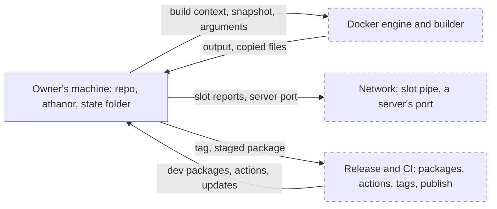
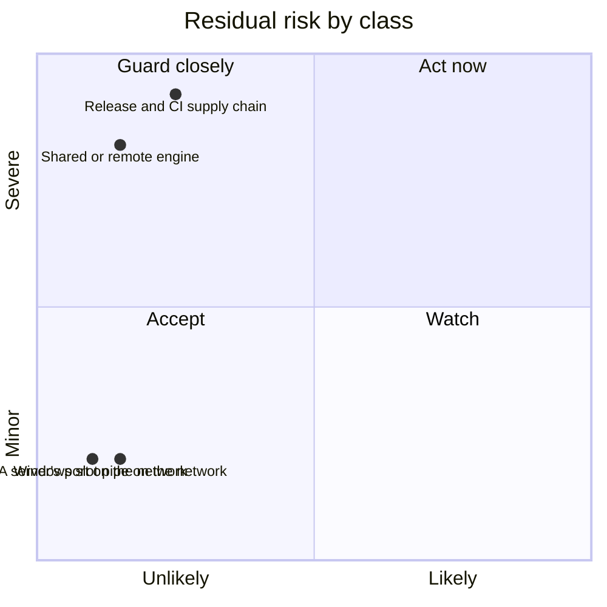

# Threat model

Read the boundaries first. Place each finding on one: where something
comes in from outside, or where an act goes out. What starts and ends on
the machine (your own computer, or a sandbox run on it) is the machine's,
and no finding; what came in from outside stays outside input. Name the
control that holds the boundary against the path, with when it doesn't
hold; if one does, add nothing. Check the residual against the classes.
Bring the owner what the guide's step 5 lists, every `security?` row
included; no class covers a change that weakens a rule or control, adds a
route for outside text into a session or more reach to one that reads it,
adds text to files sessions load, or writes a secret into text sessions
read. The full guide is the pact's review procedure, The threat model
section (`~/.claude/pact/review.md`; public copy:
https://github.com/mephistopheles4/the-pact/blob/main/claude/review.md).

[`SECURITY.md`](../SECURITY.md) says how to report a hole. The sensitive-work
list is in [`sensitive-work.md`](sensitive-work.md).

## Boundaries

### The Docker engine and builder

**Crosses:** out, the build context, the snapshot (with a base, the history
from the merge base onward: deleted files, authors, emails and messages), the
build arguments, and a command's arguments, which also sit in the engine's
record of the container; in, the test's output and the files `--output`
copies back. An engine on this machine is the machine's. The boundary is a
shared or remote engine or builder, and a local address that leads elsewhere.

**Controls:**

- **athanor** refuses an engine or builder that is not local (a unix socket,
  the local pipe in its exact form, loopback tcp) and plain tcp, unless the
  machine file sets `allowRemoteDocker` or `allowPlainTcp`; a repo cannot set
  either. What it checked is pinned for the run and checked again once the slot
  is held (ADR 0013, ADR 0021). It does not hold when an opt-in is set, or when
  a local address (`localhost` included) is forwarded elsewhere. Then the
  operator decides the result and the limits, can see the work and the build
  arguments and what the build leaves in image layers or cache, a builder can
  ask this machine for the owner's registry login, and a remote builder host
  sees the connection and, for an ssh node, the owner's login; on a shared engine other users can read runs, put their image under
  the run's tag and remove containers. With `allowPlainTcp`, anyone on the
  path can read and change the work, the output and the copied files. `serve`
  refuses an engine off this machine even with `allowRemoteDocker` (ADR 0034).
- **athanor** sends the build only the hashed set: tracked files under
  `context` and the listed `inputs`, plus `git add -N` files under `context`,
  never untracked, ignored or git files (ADR 0006). It does not hold for the
  run's container: the snapshot carries uncommitted work, and `--untracked`
  adds untracked files git doesn't ignore.
- **athanor** gives a run's container nothing from the host but the snapshot
  and `ATHANOR_GRACE_LIMIT`: no mount, no socket, the ten proxy names set empty
  so a proxy password stays out of the engine's record, and no engine log of
  the output (ADR 0016). It does not hold on an engine whose operator decides
  what is enforced, nor for a proxy name a later Docker client adds before the
  list is updated, nor for the image build, which gets the proxy settings as
  build arguments.
- **athanor** checks what `--output` copies back: names as text, regular files
  and folders only, exclusive creates, size, count and time caps, cleanup on
  error, Windows-acted file names skipped and a folder laid out as a bare git
  repository refused (ADR 0023). It does not hold for a spelling or layout it
  does not know, and never checks content: a copied file carries no
  Mark-of-the-Web, and opening or previewing it does what it holds. A remote
  operator chooses what the copy holds. The README advises
  `safe.bareRepository=explicit`.

**Residual:** the class "A shared or remote engine, and the network". It rests
on AGENTS.md's rules for the run container (ADR 0016), and on the README's
advice not to share an engine with people you don't trust.

### The network

**Crosses:** out, a slot holder's report (pid, start time, repo folder name,
limit, and a server's name and host port) on the Windows slot pipe, and a
server's published port.

**Controls:**

- **Windows** signs a user in before the pipe. It does not hold: the pipe does
  not refuse remote clients.
- **athanor** publishes a server's port on 127.0.0.1 only, and if Docker
  reports another address it removes the container and exits 125 (ADR 0034). It
  does not hold on a Linux engine before 28.0, where hosts on the same segment
  can reach a loopback port; athanor does not check the version.

**Residual:** the classes "The Windows slot pipe on the network" and "A
server's port on the network". They rest on the README's advice for each.

### Release and CI

**Crosses:** in, dev packages, actions and the update bot's pull requests; out,
the tag, the staged package, the published version and the GitHub release.

**Controls:**

- **GitHub** (read live): rulesets on `main` (a pull request, the required
  check `ci`, no deletion, no non-fast-forward), on tag creation (limited to
  admins) and on tag updates and deletions (blocked); immutable releases; secret scanning
  with push protection; Dependabot security updates; CodeQL default setup; and
  the `npm` environment's required reviewer, which gates the identity token. The
  reviewer holds only as far as npm enforces the environment the trusted
  publisher names (unconfirmed).
- **Repo files:** Dependabot waits 7 days before it proposes an update, security
  updates excepted; a bot pull request's passing check is not evidence of
  safety, and the owner's merge is the control. Actions are pinned by full SHA
  and zizmor checks each pin; install scripts are off; the lockfile pins hashes
  and `npm audit signatures` checks registry signatures; CI holds no secrets and
  a read-only token; the workflow check and the release guards (the owner as
  actor, the commit `main`'s head or behind it, CI green, the tag matching the
  version) catch honest mistakes only, and a tag run uses the workflow file at
  its commit (ADR 0035).
- **npm** binds the trusted publisher to `release.yml` and `npm`, stages only,
  and makes a version live only on the owner's two-factor approval (ADR 0019).
  It does not hold when an action in `publish` asks for the identity token and
  stages another file or version, or when `check` changes a packed file; the
  owner's look catches both. Its manifest is first seen after the version is
  live, so a bad one is unpublished while npm's policy allows, else deprecated.
- **No runtime dependencies** (ADR 0001): the compiler is the one dev package
  that runs.

**Residual:** the class "The release and CI supply chain". It rests on the
owner's rules in `docs/releasing.md`: comparing every staged file with a local
pack before login, and reading each GitHub release as a draft (ADR 0031). A
merged hijacked compiler runs as the owner and can use the owner's `gh` login
(a rebuild uses the same compiler), and any tag already pushed can still be
released. No repository setting limits who publishes a GitHub release, which
Zenodo then archives for good. Against whoever holds the owner's GitHub
account, only stage-only publishing and npm two-factor approval hold.

## Scope

**In scope:** the boundaries above: a shared or remote engine or builder, the
network, and release and CI.

**Out of scope:**

- **The machine.** Every program, process, account, file and memory made there
  is the machine's, held by its own controls (antivirus, account isolation, disk
  encryption). That covers other local programs and accounts (they can take
  slot names, fake `status`, reach a server's port, or swap a file a run reads),
  the records athanor leaves behind (the state folder, `--output` folders and
  their parents' access rules, leftover containers, a clean filter's writes in
  the repo's git folder, and paths in messages), and machine load: CPU, the
  engine's process table, a server's missing time limit (ADR 0033). What
  athanor prints reaches the session and its model provider, a boundary the
  harness holds. Anything on the machine or processed by it is out of scope.
- **A repo's own code.** athanor isolates parallel runs so they don't collide;
  it is not a sandbox for a repo you don't trust (ADR 0033). The build runs the
  repo's Dockerfile with the network and the Docker client's proxy settings,
  so a build step can send a proxy password out or leave it in the image or
  the build cache (which `prune` does not clear), and a `FROM` line can pull
  the owner's private images with their registry login. The test runs as the
  image's user with six capabilities. A copied report lands as written, and
  git's error text, printed as written, can carry terminal escape codes.
- **Third parties relied on:** Docker, Docker Desktop and its VM, git, Node,
  npm, GitHub and the operating system. The root of trust is the owner's account
  and npm two-factor approval.

athanor's own guards on what a repo supplies hold no boundary above (no shell,
git and docker by full path, the clean archive environment, the configuration
file checks: ADR 0002, ADR 0020). They are kept by AGENTS.md's rules, and only
the owner's spec loosens one (issue 84). The agent test hook
(`.claude/settings.json`, ADR 0024) is a nudge, not a control: it fails open
and reads only a command's plain forms.

## Accepted threat classes

- **The Windows slot pipe on the network.** On Windows an authenticated user
  elsewhere on the network can possibly read what slot holders report. A fix
  needs a native package, which "no dependencies" rules out, and the details are
  small.
- **A server's port on the network.** On a Linux engine before 28.0, hosts on
  the same segment can reach a server's loopback port. The owner chose a
  documented minimum over a version check.
- **A shared or remote engine, and the network.** With `allowRemoteDocker`, the
  operator and a shared engine's users receive your work and decide the result;
  `allowPlainTcp` exposes it on the path. The user chooses whom to trust.
- **The release and CI supply chain.** A hijacked dev package, action or account
  can shape what is built or staged; nothing goes live without the owner's look
  and two-factor approval. It has no README line: a user can't act on it.

## Residual risk

Positions are judgement, after the controls.

## Open issues

- **#42:** the snapshot's git calls still run the host's content filters.
- **#72:** a named base's git calls do not yet pin replace refs off on git 2.32 to 2.41.
- **#84:** controls kept only so runs don't collide are candidates to loosen.
