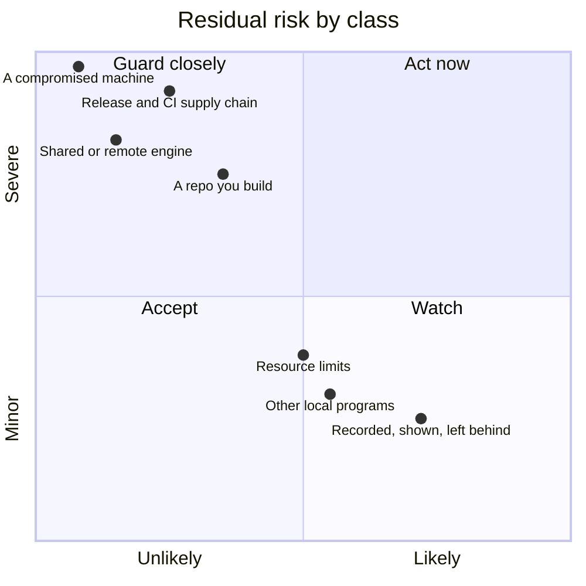
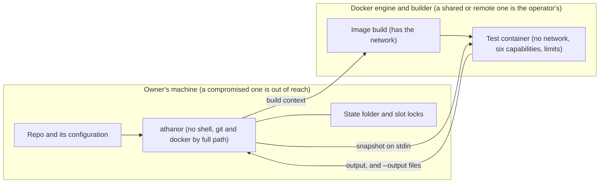

# Threat model

Last revised: 2026-11-07

This page explains how athanor could break, what it does about each way, and
which threats it accepts. Read it before you use athanor on a repo, and before
you change it. It describes athanor as at the `Last revised:` date above. A
change that alters a defence named here updates this page in the same pull
request. The owner decided the accepted classes; a change that would ease a
path a class names, or remove a control it relies on, is raised in full at
review. [`SECURITY.md`](../SECURITY.md) says how to report a hole.

## Residual risk at a glance

The chart places each class by what is left after today's guards: a repo you
build is the likeliest of the severe ones, most of the rest is rare but severe,
and the common ones are small.

| Class | Risk | L | I | What stops it | What is left open |
| --- | --- | --- | --- | --- | --- |
| [A repo you build](#a-repo-you-build) | The repo's Dockerfile and tests run with the network at build time and the snapshot at run time | 0.35 | 0.75 | No shell on the host; nothing from the host reaches the test container; six capabilities, fixed limits | The build has the network and the proxy settings; the repo's code is trusted |
| [Other local programs](#other-local-programs) | A program on the machine blocks runs, reads or fakes holder details, or plants what a run reads | 0.55 | 0.30 | The OS lock; configured paths stay in the repo; the open handle is checked | Slot names are open to any local program; point-in-time checks cannot tell a swapped path |
| [A compromised machine or sandbox](#a-compromised-machine-or-sandbox) | A program or agent already working against the owner | 0.08 | 0.97 | Nothing inside athanor | All of it |
| [A shared or remote engine, and the network](#a-shared-or-remote-engine-and-the-network) | Whoever runs the engine or builder, or sits on its path, sees and decides the run | 0.15 | 0.82 | Local engines only unless the machine file allows more; no plain tcp unless it opts in | The operator decides the result and the limits; a shared engine's users can read runs |
| [Resource limits](#resource-limits) | A run or a leftover container holds every CPU, or a raised `maxProcesses` fills the engine's process table | 0.50 | 0.38 | Memory, swap, a default process limit, the time limits, the next run's removal | No default CPU limit; a full process table can block removal |
| [What athanor records, shows and leaves behind](#what-athanor-records-shows-and-leaves-behind) | Paths, history, copied files and arguments reach places the owner did not expect | 0.72 | 0.25 | The archive step's clean environment; names checked as text; the README's advice | Host git filters run; messages carry paths; the history of a base goes wherever the snapshot goes |
| [The release and CI supply chain](#the-release-and-ci-supply-chain) | A hijacked dev package, action or account shapes what is built, staged or tagged | 0.25 | 0.92 | SHA pins, a 7-day wait, signatures, stage-only publishing, the owner's look and 2FA | A merged hijacked compiler; the release's `check` and `publish` jobs; any tag can be released |

## Scale

- **L and I** are likelihood and impact of what is left after today's guards,
  from 0 to 1. They are judgement, used to rank; they do not measure.
- **A class takes the highest L and the highest I** of the threats it covers,
  per axis, so a class can sit higher than any one of them.

## Scope

**In scope:** anything that crosses a real boundary into or out of an athanor
run: a repo's configuration, Dockerfile and tests, another local program that
can reach the slot names or the state folder, the Docker engine and builder the
user configured, and whoever runs them or sits on their network path, what a
run copies back or prints, and this repo's dev packages, actions, CI and
release path.

**Out of scope:** flaws in Docker, Docker Desktop and its VM, git, Node and the
operating system themselves. A machine already compromised as the owner's user
(see the accepted class "A compromised machine or sandbox"). The operator of a
remote engine or builder is in scope as an actor below; the software they run
is not.

## Who is in scope

| Actor | Reaches athanor through |
| --- | --- |
| The repo's own code | The Dockerfile's `RUN` lines at build time and the test suite in the container; athanor is for repos the owner trusts to build |
| Another local program, as any user | The slot names and the state folder |
| A process that can write the owner's home folder | The machine configuration or the Docker configuration, as it could the environment |
| Whoever runs the configured engine or builder, other users of a shared engine, someone on the network path | The build context, the snapshot, the result and the limits, when the machine configuration allows a remote engine |
| An authenticated network user | The Windows slot pipe |
| Whoever can publish a release of a dev package or an action CI uses, or take over the account or repository that does | CI on the bot's pull request before any merge; once merged, the compiler in every test run and the build before a publish, and the actions the release workflow uses |
| Whoever controls the owner's GitHub account, or can push a branch to this repo | The release workflow: they can stage a version, but cannot make one live without the owner's npm two-factor approval. The GitHub approval guards the token only as far as npm enforces the environment the trusted publisher names, which is unconfirmed (claim R10 of the spec on issue 6); the actor stays "can push a branch" until npm's docs say it is enforced |

## How athanor works

**The setup.** One person, the owner, runs many Claude Code sessions on one
Windows 11 machine with Docker Desktop, often in clones or worktrees of one
repo. Each session runs `athanor run` to test its work in a Linux container. CI
runs athanor on Linux. athanor uses the Docker engine and builder the user has
configured, on this machine, or on another one when the machine configuration
allows it (ADR 0012, ADR 0021).

**What athanor does.** It reads the repo configuration (`athanor.json`, or the
`athanor` key in `package.json`) and an optional machine configuration, builds
the repo's Dockerfile into an image, takes a snapshot of the work with git,
holds one of N slot locks, and pipes the snapshot into a fresh container that
runs the test command. It writes only to its state folder (`~/.athanor`, or
`ATHANOR_HOME`), except that a host clean filter can write the repo's git
folder; with `--output`, it also writes into the new folder the caller names
(ADR 0023). Both are covered by the class "What athanor records, shows and
leaves behind".

## Boundaries and how each holds

- **No shell on the host.** Every child process starts from an argument array
  with `shell: false` (ADR 0002). The source check fails the build on any
  shell use. A test command with `;`, `&&`, `$(...)`, quotes or spaces reaches
  the container as the same literal arguments (C16).
- **Nothing from the host reaches the test container** but the snapshot on
  stdin and `ATHANOR_GRACE_LIMIT`: no network for the test run (the image
  build has it, accepted class "A repo you build"), no host folder, no host environment
  value, no Docker socket, no privileged mode, and only six Linux capabilities: `CHOWN`,
  `DAC_OVERRIDE`, `FOWNER`, `KILL`, `SETUID` and `SETGID`, every other one
  dropped by an allow-list (ADR 0016, C6, C19, K1, K2, P1). The run
  blocks, with empty values, the ten proxy names the Docker CLI fills from the
  five proxy settings it reads today (accepted class "A repo you build"). A value the build
  writes into the image or its cache is accepted class "A repo you build". With a base, the
  snapshot's stream also carries the base's history: the commit, tree and file
  objects from the merge base onward, a list of the commits whose parents were
  left out, two refs and the snapshot's tree id; never a git setting, hook or
  remote (ADR 0032; accepted class "What athanor records, shows and leaves behind"). This, and
  the limits below, hold only as far as the engine enforces them: on an
  engine the owner runs, they hold; on someone else's engine, the operator
  decides (accepted class "A shared or remote engine, and the network").
- **Fixed limits on each run:** memory and memory-swap, a process limit (1024 unless `processes` is configured or `maxProcesses` is lower, held to the machine's `maxProcesses`, default 1024; N2, N3, N4), `no-new-privileges`, a host-side time limit and an in-container timer (C7, C11, K4), and CPUs when `cpus` or `maxCpus` is configured (U1, U4, accepted class "Resource limits"). The ceilings that the machine configuration sets bound what any repo can ask for, including a command's own limits (M4, N3), and `maxProcesses` bounds the process limit; only `maxCpus` has no default (C31, U3).
- **Configured paths stay in the repo.** Every `dockerfile`, `context` and
  `inputs` path is resolved through symlinks with the same realpath function
  as the repo root and compared segment by segment, ignoring case on Windows,
  before any Docker call (C17). The configuration files themselves, `athanor.json`
  and `package.json`, must each be a regular file whose real path is inside the
  repo, and must have no second hard link. The file is opened once, and the
  open handle must be the regular file that was checked, before any of its
  content is read (J6).
- **Only the hashed set reaches the build.** The build context is exactly the
  tracked files under `context`, and files added with `git add -N` under
  `context`, plus the listed `inputs`, each of which must be tracked: no
  untracked or ignored file and no git folder (ADR 0006, C28).
- **The archive step carries the tree as committed.** Every `git archive`, and
  the `git init` of athanor's archive folder, run with every inherited `GIT_*`
  variable removed, no global or system git config or attributes (on git 2.32
  or later), and no git template; the archive also has `-filter` on every
  path. So no content filter runs on the host while the stream is made, and no
  host git setting changes a file in that step. This keeps host git settings
  out of the archive step; it is not a control against a process that can
  write the environment or the home folder, which already chooses the git that
  runs. git and docker start by a full path from PATH's absolute entries, so a
  program of that name in the working folder, or one found through a relative
  or empty PATH entry, never runs in their place, which on Windows was the
  repo's own folder (ADR 0020, G8). A full PATH entry into the repo, such as
  the one npm adds for its scripts, or another spelling of the working folder,
  is the environment's choice, as above. The line endings and file modes are
  pinned, and the tree's own `text`, `eol`, `ident` and
  `working-tree-encoding` attributes still apply (ADR 0020, C32, G1–G6). The
  git calls that make the snapshot's and the build context's trees still run
  with the host's git config and environment (accepted class "What athanor records, shows and leaves behind", issue 42).
- **athanor's own git calls never write the repo.** Snapshots use a copy of the index and a
  per-run object folder (ADR 0007, C21, C30), except as accepted class "What athanor records, shows and leaves behind" says:
  a clean filter the host defines, such as Git LFS's, can write the repo's git
  folder (issue 42).
- **Docker on this machine, unless the machine allows otherwise, and never in
  clear.** A run refuses an engine or builder that is not local (a unix
  socket, the local pipe in its exact form, or tcp to loopback) unless the
  machine configuration sets `allowRemoteDocker`, which a repo cannot set; the
  machine file follows `ATHANOR_HOME`. It refuses plain tcp to the engine and
  to every builder node, and any builder whose transport it could not read,
  unless `allowPlainTcp` is set (ADR 0013, ADR 0021). What was checked is
  pinned by name for the whole run and checked again once the slot is held
  (ADR 0021; L2, L5, L6, L8, L10, L11).
- **What comes back from the container.** The test's stdout and stderr stream
  to the caller. With `--output`, the paths a named command declares are
  copied from the stopped container, addressed by its ID with the pinned
  Docker environment, into a new folder the caller names. That folder is made
  by athanor. It is owner-only on Linux (mode 0700), and on Windows it
  inherits its parent folder's access rules (accepted class "What athanor records, shows and leaves behind").
  - Names are checked as text and never resolved, `.git` included.
  - Only regular files and folders are written. Links and devices are skipped.
  - Every create is exclusive.
  - Size, entry count and time are capped.
  - On error, what was made is removed from a list (M10–M17).
- **The run limit holds through a hard kill.** The slot is an OS lock that the
  OS frees when the process ends, and a run removes its slot's labelled
  container before starting its own (ADR 0004, C8, C10).
- **Machine configuration is data.** It is validated key by key and holds no
  paths or commands.
- **Holder answers are shown, not trusted.** `status` skips an answer that is
  not one well-formed JSON line of the expected shape, or whose repo name holds
  control characters.
- **The build's own supply chain.**
  - Install scripts are off in the repo (`.npmrc`) and on CI's `npm ci`.
  - The lockfile pins each dev package by integrity hash, and every package
    resolves from the public registry.
  - CI checks registry signatures against the public registry's keys.
  - Actions are pinned by full SHA. zizmor checks each pin belongs to the
    action's own repository, using the job's read-only token, which it sends
    only to GitHub's API.
  - Updates come from the update bot after a 7-day wait, except security
    updates. A bot pull request's passing check is not evidence the update is
    safe: the wait and the owner's merge are the controls.
  - CI holds no secrets. Its token is read-only (accepted class "The release and CI supply chain").
  - The first publish is by hand, as before (`docs/releasing.md`).
  - Later versions are staged from the release workflow's `publish` job.
    GitHub issues an identity token there only after the owner approves the
    `npm` environment. That token proves the job's identity to any service
    that trusts it, including Sigstore for provenance. npm exchanges it for a
    token that can only stage, once the owner has added the trusted publisher
    with staging as its only allowed action (step 9 of `docs/releasing.md`,
    R10).
  - A staged version goes live only when the owner approves it with npm 2FA.
    The owner logs in only after the local build and logs out straight after.
    Publishing access disallows tokens, once the owner has set it before the
    merge (`docs/releasing.md` step 2, recorded in step 9).
  - See ADR 0018, A1 to A6, and ADR 0019.

## The sensitive-work list

- **Authentication and authorization.** athanor has no accounts or logins.
  The slot locks are open to any local program (accepted class "Other local programs"). It
  relies on the operating system's user separation for the state folder
  (mode 0700 on Linux; on Windows, the home folder's own access rules). The
  `--output` folder is mode 0700 on Linux, and on Windows inherits its parent's
  rules (accepted class "What athanor records, shows and leaves behind"). It relies on whatever access control the configured Docker engine has. Docker Desktop's
  local engine is the owner's; when the machine configuration allows a remote
  engine, its access control is its operator's (accepted class "A shared or remote engine, and the network"). The
  release path has its own: npm's trusted-publisher binding to this repo,
  workflow and environment, the `npm` environment's required reviewer, and
  the owner's npm two-factor approval (the supply-chain bullet above;
  ADR 0019). The GitHub release has two tag rulesets on every tag, which
  keep each tag on its commit and let only an admin create one, immutable
  releases, and the owner's read of each release as a draft before it is
  published (ADR 0031; accepted class "The release and CI supply chain").
- **Secrets.** athanor stores no secret of its own. A secret committed to the
  repo goes into the container with the snapshot, and into the build if it is
  under `context` or listed in `inputs`; the build has the network
  (accepted class "A repo you build"). With `--untracked`, the untracked files git doesn't
  ignore go into the container too, so a secret in one the ignore list misses
  goes with them; they never reach the build. With a remote engine or builder, those copies go to that
  machine when the machine configuration allows it (accepted class "A shared or remote engine, and the network"), and a
  remote builder can ask this machine for the
  owner's registry credentials (accepted class "A shared or remote engine, and the network"). A file added with `git add -N`
  goes where tracked files go. With a base, the commits from the merge base
  onward go into the container too, with every file they hold, deleted ones
  included, and their authors' names, emails and messages, and they go
  wherever the snapshot goes (accepted class "What athanor records, shows and leaves behind"). Copied outputs can hold whatever the tests
  wrote, such as a mutation report's copy of the source, and stay in the
  caller's folder, as plain files (accepted class "What athanor records, shows and leaves behind"); athanor never cleans them
  up. A named command's arguments show in the host's process list and the
  engine's record of the container (accepted class "What athanor records, shows and leaves behind"). The Docker client's proxy
  settings can hold a password: the run blocks it (ADR 0016), and the build
  receives it (accepted class "A repo you build"). Plain tcp transport is refused
  by default (ADR 0013; accepted class "A shared or remote engine, and the network" for the opt-out). Test output can hold
  secrets: athanor streams it to the caller, keeps no copy, and runs the
  container with `--log-driver none`. When the caller is an agent session, the
  output goes on to that session's model provider, as it does when tests run
  on the host. The release path holds two credentials for a short time: the
  publish job's identity token (accepted class "The release and CI supply chain"), and the owner's npm login
  around an approval, and around a step 17 unpublish or deprecate (accepted class "The release and CI supply chain"); see the supply-chain bullet above and ADR 0019. The GitHub
  release uses a third, long-lived one: the owner's gh login, kept in the
  system keyring, which can publish releases, create tags, change the tag
  rulesets and immutable releases, push branches, edit workflows and read
  the repo's private security advisories (accepted class "The release and CI supply chain"). The owner's
  npm session token sits in the user npm configuration from login to logout,
  unencrypted at file level. It relies on the machine's disk encryption, which
  the owner confirmed is on (2026-10-24), and on npm's two-factor check on
  every write.
- **Crypto.** SHA-256 keys the image cache and is not a security control,
  except that on a shared engine the tag is the only link between a run and
  its image (accepted class "A shared or remote engine, and the network"). Temporary names use Node's crypto random source.
  athanor encrypts nothing itself; transport to a remote engine or builder is
  ssh or verified TLS unless `allowPlainTcp` is set (ADR 0013, ADR 0021). The
  `--output` folder sits unencrypted on the host's disk, like the state folder.
  With a base, a run's pack of the base's history sits unencrypted in the state
  folder until the run has streamed it into the container (or, if it can't be
  removed then, until the run ends), and after a hard kill until the stale-run
  sweep, like the rest of it.
  Image layers, the build cache and a container's writable layer sit
  unencrypted on the engine's or builder's disk: on this machine they rely on
  its disk encryption; on a remote one, which the machine configuration must
  allow, on that machine's owner (accepted class "A shared or remote engine, and the network"). `prune` does not clear Docker's build
  cache; the README names the commands that do. Each released version's
  provenance is signed by npm through Sigstore (the supply-chain bullet above;
  ADR 0019).
- **Input validation.** Repo configuration, machine configuration,
  environment values, CLI arguments, command names and configured paths are
  each validated before use, and a bad value exits 125 with a plain message
  (C17, C18, C24, C31, N4). A named command's arguments are accepted only when it
  sets `args`, and are passed as literal arguments (M5, M6). The `outputs`
  entries, `--output`, and every entry name and header in a copied tar are
  checked too (M10, M11, M13). The engine endpoint and every builder node are
  checked for locality and plain tcp, read as Docker reads them (a value with
  no "://" is tcp; a pipe in one exact form), pinned for the run and checked
  again once the slot is held (ADR 0013, ADR 0021; L1, L2, L5, L8, L10, L11). Holder answers are shown as reported, never as checked facts.
  git settings, attributes, templates and `GIT_*` variables inherited from the
  host are kept out of the archive step (ADR 0020); the git calls that record
  the work still use them (accepted class "What athanor records, shows and leaves behind").
  A base name is checked before git sees it (no leading `-`, no revision
  syntax, no control or format character), then resolved, with the ambiguity
  check pinned on, to one branch, remote-tracking branch or tag (a command's
  `base` to the last two), in ADR 0020's clean environment with the repo's own
  config still read, replace refs off (on git 2.32 to 2.41 the repo's own
  config may turn them back on, issue 72), grafts off, and lazy fetching off on
  git 2.45 and later. The name git resolves to gets the same control-set check. A
  shallow or partial clone, and a snapshot holding the reserved path, are
  refused; on git 2.32 to 2.44 the partial-clone refusal is the only guard
  against a fetch (ADR 0032; B1, B5, B7).
  The release path's untrusted inputs are the artifact `publish` takes from
  `check`, the staged tarball the owner downloads, the registry's manifest,
  which is checked once the version is live, and the
  registry's answer to the version check. They are covered by the owner's
  look before approval (`docs/releasing.md`), accepted class "The release and CI supply chain", and
  ADR 0019.
- **Data migrations.** None. The state folder holds only marks, temporary
  indexes and per-run folders (with a base, a run's pack of the base's
  history among them), which are safe to delete.

## Accepted threat classes

The owner accepts each class below. A finding that fits one needs nothing,
though a session may still fix it in passing if it's cheap. A finding that fits
none comes to the owner as a new class, and only a merge the owner confirms
adds or widens one. A class says what it covers, never the steps. A class a
user has to act on or know about has a line in the README's "What athanor
doesn't protect you from"; the release and CI class stays here alone.

- **A repo you build.** The image build runs the repo's own Dockerfile with
  the network, so a repo from someone else can run code that reaches the
  internet, and a `FROM` line can pull the owner's private images with the
  owner's registry login and send their content out. The build also gets the
  Docker client's proxy settings as build arguments, and a proxy setting can
  hold a password: a build step can send it out or print it into the build
  output, which reaches the caller and, from an agent session, the model
  provider; a Dockerfile can leave it in the image's files, metadata or
  history, or in the build cache, which `prune` does not clear, where the test
  run, the engine's operator and a shared engine's other users can read it.
  Files added with `git add -N` under `context` reach the build too. A proxy
  setting that a later Docker client adds reaches the container until
  athanor's list of ten blocked names is updated. The test runs as the image's
  user, root unless the Dockerfile names another, with six Linux capabilities
  that a flaw in Docker or the kernel could use to read or change what root
  can reach on the engine's machine, and the run limit is the owner's own
  setting. What a copied file holds is the test code's choice: athanor checks
  names and types, never content, so a report lands as written and opening it,
  or a viewer previewing it, does what it holds; copied files carry no
  Mark-of-the-Web; and what the test read inside the sealed container leaves
  this way. athanor skips the file names Windows acts on when it shows a
  folder (`desktop.ini`, `.lnk`, `.url`, `.scf`, `.library-ms`,
  `.searchConnector-ms`, theme files), and refuses a folder laid out as a bare
  git repository it recognises; a spelling or layout it does not know is
  written, so the README advises `safe.bareRepository=explicit`. Git's error
  text is printed as git wrote it, so a name in the repo can carry terminal
  escape codes to the caller or session. Accepted because athanor is for repos
  the owner trusts to build, most Dockerfiles need the network, blocking the
  proxy would mean athanor choosing the build's Docker configuration (ADR
  0012), the other five capabilities are what a root-run test can plausibly
  need and `KILL` is what the in-container time limit needs, and a host run of
  the same tool writes the same files and prints the same text.

- **Other local programs.** Any local program can take the slot names to
  block runs, or answer `status` with false holder details, and can read the
  details a holder reports (pid, start time, repo folder name, limit); on
  Windows possibly an authenticated network user can too, since the pipe does
  not refuse remote clients. A program that owns a slot name and holds the
  Windows privilege to impersonate clients can act with the owner's identity
  for that connection. A program that can write the repo or the folders around
  it can swap a folder under an in-repo link to a configuration file while a
  run reads it, give an outside file its only name in the repo for the moment
  of the read, or mount a file over a configuration name on Linux (root), so
  that at most a key name or path value from it appears in a message; a
  dangling link named `athanor.json` counts as absent, so the `athanor` key in
  `package.json` is used with no conflict message; and on Windows a link at the
  repo root to a network location is followed before athanor tests whether it
  is inside the repo, so the machine can start a sign-in there, with no content
  read. An endpoint athanor counts as local, a `unix://` socket, the local pipe
  or a loopback port, can lead elsewhere: forwarded to another machine, or
  held by another local program while the engine does not (Docker Desktop
  stopped, say); `localhost` is trusted as loopback. The agent test hook (ADR
  0024) is a nudge, not a control: it fails open on any error, stays silent
  when it cannot find athanor, and reads only a command's plain forms. Accepted
  because limiting the Windows pipe needs a native package, which "no
  dependencies" rules out; a process with the impersonation privilege can
  usually reach SYSTEM anyway; each file path needs write access the owner's
  own programs already have, or mount privilege, with a gain limited to what a
  message shows; athanor cannot tell where a local address leads without
  trusting the machine, and Docker offers no check of the engine's identity;
  and the hook exists to make a skipped rule visible.

- **A compromised machine or sandbox.** Once a program, process or agent on
  the machine or in the sandbox works against you, it can plant programs a
  bare command name runs, change files a session or a hook reads, and act as a
  session would; athanor does not defend against it. That covers local prompt
  injection and planted files: a rogue agent in the system can change what a
  session reads and runs, and athanor cannot tell it from the owner. It adds
  to the actors this page lists and to the machine "already compromised as the
  owner's user" under Out of scope. It takes over none of the paths the class
  "Other local programs" names, and no control named here is removed or eased:
  the argument-array starts, the full-path git and docker lookup, the clean
  archive environment and the container's limits keep holding against what they
  hold against. Accepted because a program that already acts as the owner or as
  a session reaches everything athanor reads and starts, so no control inside
  athanor can stop it.

- **A shared or remote engine, and the network.** With `"allowRemoteDocker":
  true` in the machine configuration, athanor uses the engine and builder the
  user has configured, including one on another machine or a cloud builder.
  Whoever runs it receives the build context and the snapshot, uncommitted
  changes, files added with `git add -N` and any committed secret included,
  and keeps copies in its image layers and build cache. It decides the result
  athanor reports, whether "no network" and the limits are enforced, the text
  streamed back into the session and the files a copy writes to the host; as a
  builder it can ask this machine for the owner's registry credentials; and
  before athanor decides on a builder, `buildx inspect` contacts its nodes, so
  a remote builder host sees the connection and, for an ssh node, the owner's
  login, but no repo data. Other users of a shared engine can put their own
  image under the tag athanor runs, read the snapshot in a running container
  and the build context in an image, reach a stopped container for the length
  of a copy, and remove containers, which also breaks the run limit across
  machines. With `"allowPlainTcp": true`, the snapshot, the build context, the
  build arguments, the test output and copied files cross the network
  unencrypted, readable and changeable by anyone on the path; plain tcp to
  another host also needs `allowRemoteDocker`, and the opt-in covers builder
  nodes and builders whose transport athanor could not read (ADR 0021).
  Accepted because the owner chose to let athanor run against any Docker the
  user sets up and the user chooses whom to trust with that; the README and
  SECURITY.md say not to share an engine with people you don't trust; and the
  opt-ins can be set only in the machine configuration, never by a repo.

- **Resource limits.** A test that kills the in-container timer, together with
  a hard-killed caller, leaves one container running until its slot is next
  used, when the next run removes it; until then it keeps the run's snapshot,
  uncommitted files included. With no CPU limit configured (`maxCpus` unset), a
  run, or such a leftover container, can keep every CPU the engine has busy,
  which on Docker Desktop is every core of the VM, slowing the host and the
  owner's other runs; the run's time limit ends it. A machine that raises
  `maxProcesses` lets a repo's test code hold that many processes in each
  run, all from the engine's one process table; several runs near a high
  ceiling can fill it, and the engine and its other containers then cannot
  start processes (on Docker Desktop that may reach other programs sharing the
  VM; on a Linux host the table is the host's own). While it is full,
  athanor's stop at the time limit may fail to start, so a test that has ended
  the in-container timer can outlast the limit, and removing a leftover
  container can fail too, so recovery may need an engine restart (on Linux,
  the host's own recovery). A ceiling near the top (4194304) is in effect no
  limit. Memory, swap and the default of 1024 processes stay bounded. Accepted
  because the next run on the slot removes a leftover container, the owner
  chose speed by default and `maxCpus` bounds it, the repo is code the owner
  trusts to build, raising the ceiling is the machine owner's act, and the
  README advises keeping `maxProcesses` times the largest run limit, plus the
  engine's other containers, well below the engine's process limit.

- **What athanor records, shows and leaves behind.** The git calls that make
  the snapshot and the build context (`stash create`, `add`, `hash-object`)
  run with the host's git config and environment, so a clean filter the repo's
  attributes name runs on the host, its output reaches the container and the
  build, and Git LFS's filter writes the repo's `.git/lfs` folder, where the
  copy stays, including, with `--untracked`, files the owner has not added
  (issue 42). Messages that name the machine configuration file, a path in the
  state folder, or the repo carry the full path, which holds the account's
  home-folder name, to whatever reads athanor's output, such as an agent
  session and its model provider; an unexpected file-system error while
  copying, such as a full disk, can end athanor with a stack trace showing
  local paths, though the copy is still removed and the slot released. The
  `--output` folder gets no access rules from athanor and, on Windows,
  inherits its parent's: under a parent other accounts can read, they can read
  the copied files, and under a parent they can change, they can swap a folder
  inside it for a link while the copy runs, so a write or cleanup lands
  elsewhere the owner can write, on any platform without a sticky bit; every
  path is built from the parent's real path recorded at the start, which
  narrows the swap of the parent but not of a folder inside. Copied outputs sit
  as plain files with nothing encrypting them, and can hold a copy of the
  source or anything the test read; the README advises a parent under the user
  profile. A named command's arguments show in the host's process list, in the
  engine's record of the container until it is removed, and to a remote
  engine's operator. A named base carries every commit from the merge base
  onward, on the base's side and the branch's, into the snapshot: its files, a
  file since deleted (a secret, say) among them, and its metadata (author and
  committer names, emails, dates, messages with trailers, signatures, a merged
  signed tag's tagger and message). It lands in the container's repository,
  where the test code can read it and the output can carry it out, and it goes
  wherever the snapshot goes; a run killed hard can leave its pack of that
  history, unencrypted, in the state folder until the stale-run sweep a day
  later. Accepted because the owner's own `git add` runs the same filters and a
  fix changes what the snapshot holds (issue 42); the names are the owner's
  own, going to the owner's own session, and naming the file to fix is what
  makes a message actionable; the rare failure is not worth wrapping each file
  call in code; the owner chose the folder's place and a host run's reports
  land under the same rules; the repo's working tree sits unencrypted on the
  same disk; the README says not to pass secrets as arguments; and the history
  is the repo's own, a base is named only for checks that need it, and the test
  container has no network.

- **The release and CI supply chain.** A hijacked release of a dev package or
  an action that CI uses, or a taken-over account or repository, runs in CI on
  the bot's pull request before any merge, with the job's read-only token, and
  can set that check's result; CI holds no secrets. Once merged, the
  TypeScript compiler, the one dev package that runs, runs as the owner in
  every test run and in the build before a publish: it can read what the owner's
  account can read, shape the published code, and use the owner's `gh` login,
  kept in the system keyring between releases, with which it can publish a
  GitHub release (a permanent Zenodo record), create tags, edit or delete the
  tag rulesets, turn immutable releases off, push branches, edit workflows and
  read the repo's private security advisories; a rebuild uses the same
  compiler, so it cannot see the change. A hijacked action run on a push to
  `main` can write Actions cache entries that a later workflow restoring the
  cache would read; nothing restores a cache today, and the workflow check
  fails one that does. Code in the release's `check` job (a dev package, the
  compiler, the test code, an action, or a process an earlier step left
  running) can change any file that is packed, and `publish` stages exactly
  that; the owner's comparison of every staged file with a local pack of the
  same commit, before the login, catches every change made only on the runner.
  An action in the `publish` job (`actions/download-artifact`,
  `actions/setup-node`, or the npm it provides) can ask for the identity token,
  and with it stage another tarball or extra versions, use up the 2-day
  validation of a new trusted publisher, or get a Sigstore signature in this
  workflow's name for some other file. The registry's manifest, which a publish
  sends apart from the tarball, is first seen in step 17's `npm view`, after
  the version is live, so whoever installs before then gets that manifest's
  dependencies; a bad one is unpublished while npm's policy allows, else
  deprecated, and a deprecated version still installs. From `npm login` to
  `npm logout`, around an approval and around a step 17 unpublish or
  deprecate, the npm session token sits in the user npm configuration
  unencrypted at file level, readable by any program running as the owner,
  including one left behind by the local build. Whoever can write to the repo,
  or act as the owner's account, can publish a GitHub release on any tag
  already pushed, and Zenodo then archives that tag's tree for good and mints a
  DOI; the tag rulesets keep each tag on its commit and let only an admin
  create one, but no repository setting limits who publishes a release.
  Accepted because the wait before the update bot's pull requests, the
  registry's signatures, the SHA pins, the owner's merge, stage-only
  publishing, the owner's look at the staged version and the owner's npm
  two-factor approval narrow every window, nothing goes live without that look
  and approval, no cheap independent check of the compiler's output exists,
  npm requires two-factor on every write, and no other collaborator or deploy
  key can write to the repo; the owner makes each release by hand, as a draft
  read before it is published (ADR 0019, ADR 0031).

## Open issues

- **#42:** the snapshot's git calls still run the host's content filters and
  can write the repo's LFS store.
- **#72:** a named base's git calls do not yet pin replace refs off on git 2.32
  to 2.41, or match an inherited `GIT_DIR`.
